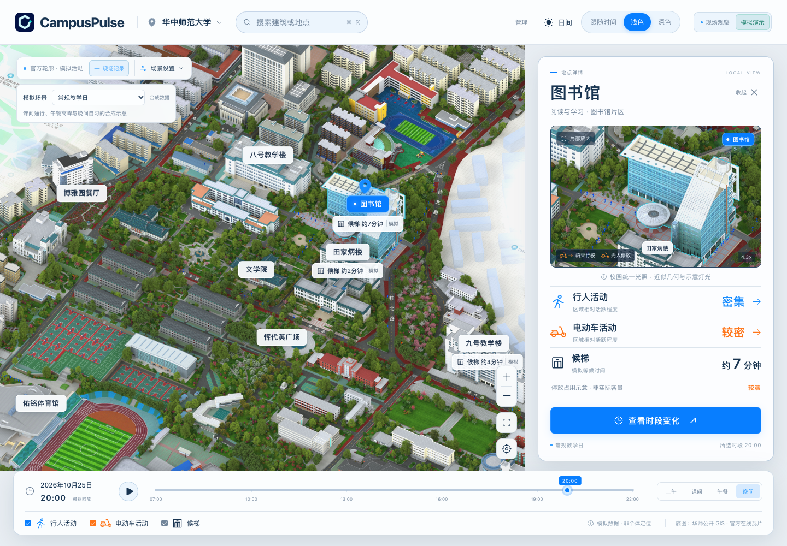
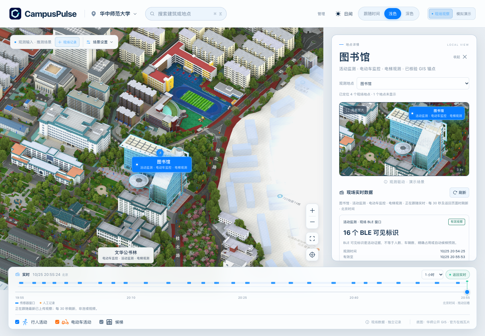
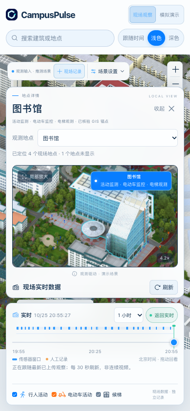

# CampusPulse

[简体中文](README.zh_CN.md) · [Try the prototype](https://pulse.anend.net) · [Documentation](docs/README.md)

**Hackathon deadline: 25 October 2026, 20:00 Beijing time (UTC+8 / 12:00 UTC).**
Repository snapshot: [`hackathon-2026-10-25`](https://github.com/Aiaid/CampusPulse/tree/hackathon-2026-10-25).
The tag records the historical frontend and README snapshot, prepared after the deadline.
Current source follows the [V3-only migration](docs/notes/v3-only-migration-2026-10-31.md).

CampusPulse is a campus observation map we are building for Central China Normal
University (CCNU). It started with the idea of a Bluetooth activity heatmap;
CCNU's existing GIS, e-bike parking problems and elevator waits led us to explore
vehicle evidence and elevator-lobby events, alongside a shared live/history
timeline. Current V3 firmware uploads bounded BLE statistics; calibrated vehicle
identification and wait estimates remain research work.

## Earlier Bluetooth map projects

Other universities have explored Bluetooth-based campus maps. The University of
Notre Dame's [N-Distance](https://wireless.nd.edu/research/collaborative-intelligent-radio-systems-for-congested-wireless-environments/)
uses participants' phone locations and Bluetooth sightings to map when and where
interactions occur on campus. Participants install an app and carry a beacon.

The hackathon project [CrowdMap](https://devpost.com/software/crowdmap-2tqdch)
takes a hardware approach closer to ours: an ESP32 scans nearby Bluetooth
advertisements and sends statistics to a web heatmap showing changes over time.

These projects offer a starting point: observe activity around a place through
Bluetooth signals, then put those observations on a map.

## What we changed for CCNU

CCNU already has an [official campus GIS](https://gis.ccnu.edu.cn/), with a base
map of buildings, roads and places. We use that map and attach observation
points and records to locations people already know.

E-bike parking is another reason for the project. A university
[report on its Nanhu campus safety inspection](https://www.ccnu.edu.cn/info/1073/37372.htm)
explicitly raised parking difficulties and disorderly parking, and called for
expanding parking spaces. Alongside activity changes, we want to record how many
bikes were seen at a parking point, when the observation was made, and how it
changes during the day.

Current V3 firmware extracts bounded BLE statistics with versioned quality and
loss counters. The default `unclassified-v1` ruleset leaves observed identifier
keys in `unknown`; it does not identify each nearby device as a vehicle or turn
identifier counts into people or parked-bike counts. Earlier Radar rules and
collected records remain historical research evidence. Manual parking
observations are retained as a separate source for cross-checking.

Elevator-lobby visibility changes can provide candidate events for research.
They do not establish boarding or a person's wait duration. Completed manual
wait observations remain historical references; a calibrated automatic wait
estimate is unavailable.

We also added one time axis for live observations and historical review. Once
field data is uploaded, we can look back at changes at the same place and see
both the recorded intervals and the gaps.



*Simulation screenshot. The base map comes from CCNU GIS; people, vehicles and
lighting are illustrative.*

## Using the map

Choose a place and follow its latest observations. Drag the horizontal time axis
or click a record marker to pause at an exact historical time. Select
**返回实时** (Return to live) to follow the latest data again.

<table>
<tr>
<td width="72%"></td>
<td width="28%"></td>
</tr>
<tr>
<td>Uploaded observations and the shared timeline on desktop.</td>
<td>The same deployed observation view on a phone.</td>
</tr>
</table>

*Captured from the deployed frontend on 25 October 2026 after the deadline.
Field cards show uploaded records with their original times and quality labels.
Animated people and vehicles are an inferred illustration, with the requested
2× drawing scale; they are not measured headcounts or vehicle counts.*

[How these screenshots are captured](docs/notes/readme-screenshots.md).

## Explore the prototype

- [**现场观察 · Observations**](https://pulse.anend.net/?mode=field): follow live data, drag back through retained history, then return to live.
- [**模拟演示 · Simulation**](https://pulse.anend.net/?mode=demo): explore teaching-day, weekend and rainy-day scenarios with synthetic activity and animation.

The deployed prototype may lag the current code. Observations retain the last
uploaded records with their original timestamps and expiry labels. Where an
observation drives the demo renderer, the scene is labelled as inferred; its
illustrative values never become field records or fill historical recording gaps.

The observation axis starts with the last hour and offers 15-minute, one-hour
and 24-hour ranges. Reads return at most the newest 200 records per stream;
truncation is visible, so a 24-hour range does not promise a complete recording.
Real-data review currently depends on the online API and has no offline file
player or automatic playback. The older `?mode=replay` link opens this same axis
at its newest retained record.

Only observation points with verified map positions are marked; buildings on
the base map do not imply installed sensors. Records for unlocated places remain
available in the data selector.

## Managing devices and data

Current device transport is **native MQTT/TLS → Hangzhou EMQX → Cloudflare**.
The V3 gateway requires a CPV3 frame and returns an exact Cloudflare application
receipt; broker delivery alone does not authorize local queue reclamation.
The existing `cp/v1` MQTT topic namespace remains for deployed broker ACLs;
its name does not enable a V1 device payload. MQTT identities and private setup
material stay out of Git. See [MQTT operations](docs/notes/mqtt-production.md)
and the [public CA certificate](firmware/certs/README.md).

The [administrator workspace](https://pulse.anend.net/admin) retains account,
Passkey, device identity, placement, site-settings and audit operations. V3
configuration uses the device's actual capability snapshot, validated immutable
policy assignments and explicit device acknowledgements. Publication, device ACK
and stored statistics are separate states. Devices without an actual V3 capability
report are not given an invented profile. Setup for the active V3 applications
uses physical USB; historical BLE and device-hotspot wizards are retired.

Diagnostics and private evidence use V3 capabilities, assignments, acknowledgements,
leases and stored statistics. Missing measurements remain unknown. The public map
reads eligible V3 field statistics with their original policy ID and assignment
generation; it does not fall back to V1/V2 sensor rows. Manual observations remain
independent. Existing V1/V2 D1 records, receipts and private R2 objects are preserved,
although their ingestion/control routes now return 404 and legacy retention is
stopped. Historical data preservation does not imply that every retired record
has a current UI reader.


*Historical local administrator interface with browser-local sample data. Names
are labelled “样例” (sample). This screenshot predates the V3-only migration and
is not the current V3 console or hardware acceptance evidence.*

Normal cloud uploads contain small statistics and status records. Cloud raw and
per-address uploads remain off for the selected production profile. Local TF
research recording and the separately gated private CPRAW archive contract have
independent custody and acceptance boundaries. D1 stores versioned V3 records and
durable receipts; private historical R2 data is retained.

See the [V3-only migration](docs/notes/v3-only-migration-2026-10-31.md),
[V3 small-statistics contract](docs/specs/v3-small-statistics.md) and
[administrator account security](docs/specs/admin-auth-v1.md).

## Shared firmware and board adapters

The active network applications are [Waveshare V3](firmware/waveshare-v3/README.md)
and [T-Energy-S3 V3](firmware/t-energy-v3-trial/README.md). They share bounded
`cp_v3_*` collection, statistics, control, queue and transport components while
keeping board pins, power, display and Flash layouts specific to each board.
Both wait for physical USB setup and retain their documented bounded runtime
limits; they are not unattended five-board deployment firmware.

| Board family | Available source and verification status |
| --- | --- |
| FoloToy AI Passport / ESP32-C3 | BSP, fonts, licenses and historical evidence are retained. Its V1/V2 network application entry is retired; no current C3 V3 application is claimed. |
| LILYGO T-Energy-S3 / ESP32-S3 | [V3 application](firmware/t-energy-v3-trial/README.md), bounded statistics, MQTT and checkpoint recovery. Earlier production MQTT acceptance is historical evidence for its tested image. |
| Waveshare ESP32-S3-ePaper-1.54 V2 | [V3 application](firmware/waveshare-v3/README.md), local TF recording, MQTT and Chinese UI. “V2” identifies the hardware revision, not the retired device protocol. |


*Historical interface with illustrative measurements, preserved with its source
record. It predates the V3-only diagnostics and is not a physical measurement.*

The independent [offline raw recorder](firmware/waveshare-raw/README.md), CPRAW
formats, BSP and V3 local-TF dependencies remain available. Read-only compatibility
with older saved NVS credentials preserves device settings; it does not restore
old upload protocols. Historical Flash queues are not converted, replayed or
erased by source retirement. Preserve the Passport's protected data and partition
layout; never apply that layout to S3 boards or erase the entire Flash.

See the [firmware guide](firmware/README.md),
[bounded T-Energy runtime](firmware/t-energy-v3-trial/BOUNDED_RUNTIME.md) and
[production acceptance record](docs/notes/v3-production-release-2026-10-31.md).

## Current progress

The web app retains the official GIS, dual maps, shared live/history axis,
independent visual layers, manual observations and a separate simulation.
Illustrative actors and lighting retain their provenance and never fill gaps in
field records. V3 sensor reads preserve source policy/generation, timestamps,
uncertainty and quality. Unknown categories and population estimates remain
unknown; candidate events do not become measured elevator waits.

The [earlier bounded production release](docs/notes/v3-production-release-2026-10-31.md)
records real two-board MQTT, exact receipts and planned-restart checkpoint checks.
The V3-only source cleanup passes 1,170 repository tests, the production build,
MQTT gateway/browser checks and fresh S3 builds/host verification. Publication
is established by the actual main CI/deployment workflow; these local results
include no new flash or physical acceptance of the resulting images. It preserves historical
D1/R2 data and retires only old device protocol/application paths. Long offline
operation, arbitrary power loss, saturated load, battery calibration and field
inference validation remain open. See the
[migration record](docs/notes/v3-only-migration-2026-10-31.md) and
[roadmap](docs/design/ROADMAP.md).

## Hackathon demonstration

The hardware is still unstable, and sustained collection and upload remain
under active debugging. Outdoor devices left unattended are also at risk of
theft, so the prototype is demonstrated through temporary, attended setups.
For the hackathon submission, an on-site demonstration with the devices can be
arranged on request to show collection, campus Wi-Fi upload and the web interface.


*User-provided operation screenshot of the library observation page. The displayed
16 BLE identifiers are marked as capped and do not mean 16 people; the activity
icons are illustrative. Elevator observations are still pending in this snapshot.*

## Run locally

Use **Node.js 24**. From the repository directory:

```sh
npm ci
npm run build
npm run db:migrate
cp .dev.vars.example .dev.vars
```

Edit the ignored `.dev.vars` and replace `OPERATOR_TOKEN` with a random local
credential. Set an independent `ADMIN_TOKEN` if you need administrator setup;
keep credentials out of source and screenshots.

Start the API:

```sh
npm run dev:api
```

In another terminal, start the frontend:

```sh
npm run dev
```

Open [localhost:5173](http://localhost:5173/?mode=field). Vite proxies `/api` to
the Worker on port 8787. A fresh local database has no field recordings; choose
simulation to explore the visual experience. Run `npm test` and `npm run build`
for the automated checks. More setup details are in the [development guide](docs/notes/development.md).

## Stack and documentation

The stack is React 19, Vite, TypeScript/JavaScript and PixiJS/Canvas/CSS, with
Cloudflare Workers Static Assets, a Workers API, D1 and private R2. Firmware uses
ESP-IDF/FreeRTOS. GitHub hosts source and CI; Cloudflare hosts the application.

- [Architecture](docs/notes/architecture.md) and [API documentation](docs/specs/web-api-v0.md)
- [Administrator setup](docs/specs/admin-auth-v1.md) and [V3 firmware](firmware/README.md)
- [V3 configuration](docs/specs/device-v3.md), [MQTT contract](docs/specs/device-v3-mqtt.md) and [migration boundaries](docs/notes/v3-only-migration-2026-10-31.md)
- [CI/CD and deployment](docs/notes/ci-cd.md)
- [Source provenance and reuse boundaries](docs/notes/reuse.md), [contributor rules](AGENTS.md) and [full documentation index](docs/README.md)
