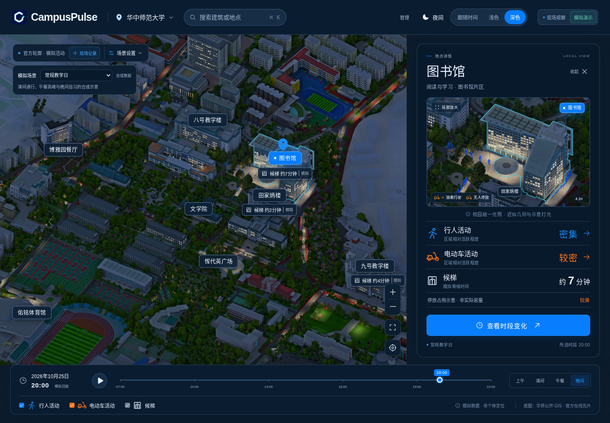
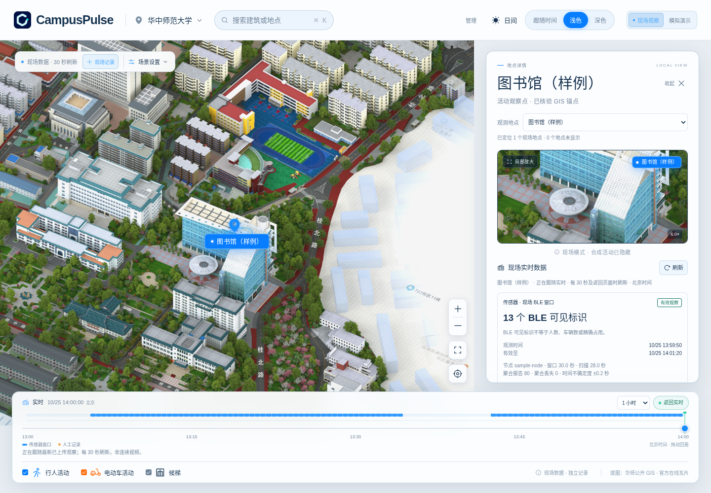
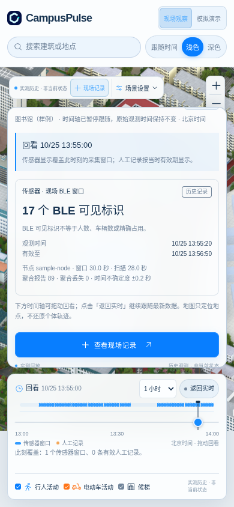
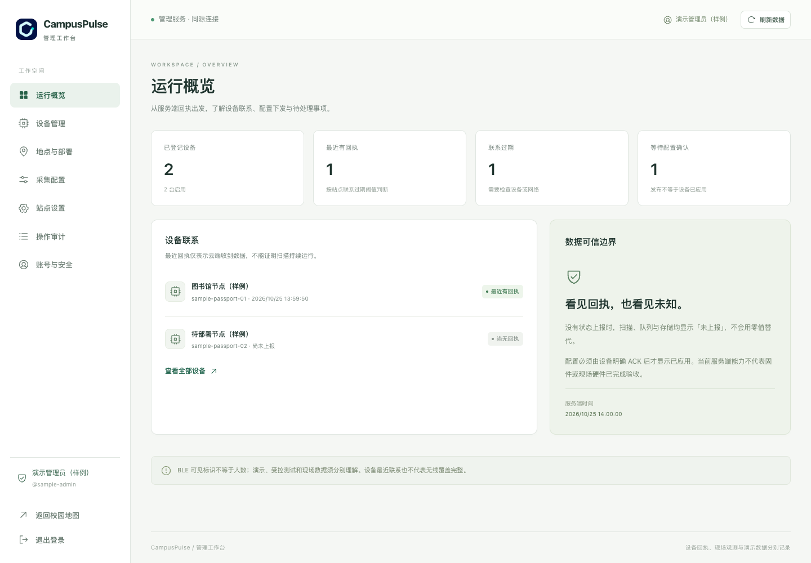
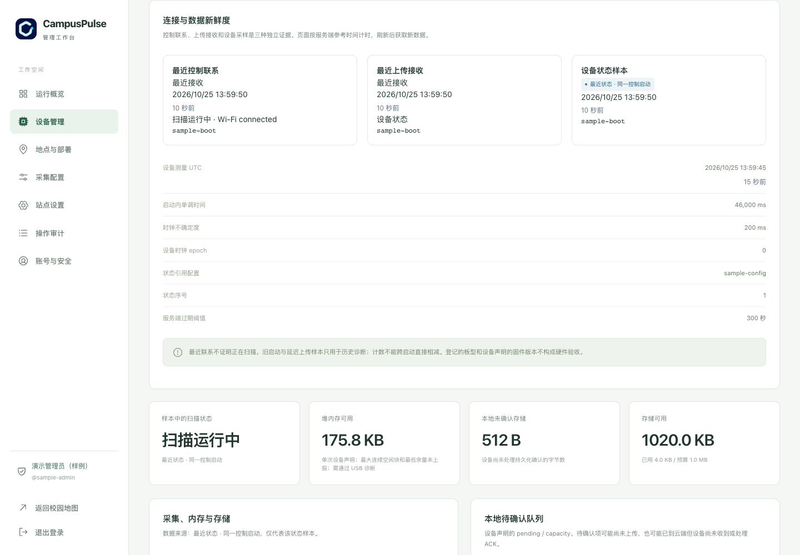
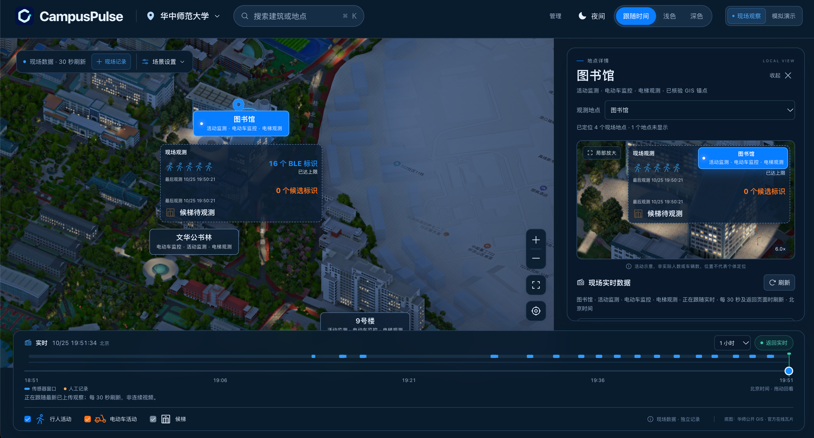

# CampusPulse

[简体中文](README.zh_CN.md) · [Try the prototype](https://pulse.anend.net) · [Documentation](docs/README.md)

CampusPulse is a campus observation map we are building for Central China Normal
University (CCNU). It started with the idea of a Bluetooth activity heatmap;
CCNU's existing GIS, e-bike parking problems and elevator waits led us to add
on-device e-bike identification, Bluetooth event analysis at elevator lobbies
and a shared live/history timeline.

## Earlier Bluetooth map projects

Other universities have explored Bluetooth-based campus maps. The University of
Notre Dame's [N-Distance](https://wireless.nd.edu/research/collaborative-intelligent-radio-systems-for-congested-wireless-environments/)
uses participants' phone locations and Bluetooth sightings to map when and where
interactions occur on campus. Participants install an app and carry a beacon.

The hackathon project [CrowdMap](https://devpost.com/software/crowdmap-2tqdch)
takes a hardware approach closer to ours: an ESP32 scans nearby Bluetooth
advertisements and sends statistics to a web heatmap showing changes over time.

These projects offer a starting point: observe activity around a place through
Bluetooth signals, then put those observations on a map.

## What we changed for CCNU

CCNU already has an [official campus GIS](https://gis.ccnu.edu.cn/), with a base
map of buildings, roads and places. We use that map and attach observation
points and records to locations people already know.

E-bike parking is another reason for the project. A university
[report on its Nanhu campus safety inspection](https://www.ccnu.edu.cn/info/1073/37372.htm)
explicitly raised parking difficulties and disorderly parking, and called for
expanding parking spaces. Alongside activity changes, we want to record how many
bikes were seen at a parking point, when the observation was made, and how it
changes during the day.

The device now identifies e-bikes automatically from Bluetooth advertisements.
Its rules use vehicle-brand names and known vehicle-module manufacturer IDs,
exclude known phone, accessory and office-device signatures, and check sustained
presence. Identified vehicles and uncertain devices are counted separately; see
the [on-device rules](firmware/ai-passport-radar/main/veh_rules.c).

Automatic identification is the main source for parking observations. Manual
entry remains available for supplementary records and cross-checks, rather than
requiring someone to identify each vehicle. The count refers to vehicles matched
by the rules, not every nearby Bluetooth device.

Elevator waiting time is another problem we want to address. We use Bluetooth
observations at the lobby to detect when a group of previously stable signals
disappears together, producing candidate boarding events for reviewing changes
in elevator-lobby activity. The rules already produce these candidates; deriving
actual wait durations still needs field calibration. The time taken to confirm
an event is not the time someone spent waiting.

We also added one time axis for live observations and historical review. Once
field data is uploaded, we can look back at changes at the same place and see
both the recorded intervals and the gaps.



*Simulation screenshot. The base map comes from CCNU GIS; people, vehicles and
lighting are illustrative.*

## Using the map

Choose a place and follow its latest observations. Drag the horizontal time axis
or click a record marker to pause at an exact historical time. Select
**返回实时** (Return to live) to follow the latest data again.

<table>
<tr>
<td width="72%"></td>
<td width="28%"></td>
</tr>
<tr>
<td>Live observations and the shared timeline on desktop.</td>
<td>Historical review on a phone.</td>
</tr>
</table>

*These two interface screenshots use test data. The place is labelled “样例”
(sample); these are not field recordings.*

[How these screenshots are captured](docs/notes/readme-screenshots.md).

## Explore the prototype

- [**现场观察 · Observations**](https://pulse.anend.net/?mode=field): follow live data, drag back through retained history, then return to live.
- [**模拟演示 · Simulation**](https://pulse.anend.net/?mode=demo): explore teaching-day, weekend and rainy-day scenarios with synthetic activity and animation.

The deployed prototype may lag the current code. Observations show uploaded
records and leave missing data empty. Simulation is a separate way to try the
interface; its values never fill gaps in field records.

The observation axis starts with the last hour and offers 15-minute, one-hour
and 24-hour ranges. Reads return at most the newest 200 records per stream;
truncation is visible, so a 24-hour range does not promise a complete recording.
Real-data review currently depends on the online API and has no offline file
player or automatic playback. The older `?mode=replay` link opens this same axis
at its newest retained record.

Only observation points with verified map positions are marked; buildings on
the base map do not imply installed sensors. Records for unlocated places remain
available in the data selector.

## Managing devices and data

CampusPulse includes an [administrator workspace](https://pulse.anend.net/admin)
for operating the observation network alongside the public map. Its pages and
APIs cover the device lifecycle:

- **Register and deploy:** register devices, enable or disable access, rotate
  device credentials, assign places and retain deployment history. The setup
  wizard supports browser BLE, desktop USB and a device-hosted Wi-Fi setup page,
  subject to device and browser capabilities. Existing devices can change their
  network settings without being registered again.
- **Configure collection:** edit versioned drafts, check their limits and publish
  an immutable capture policy. The console distinguishes the desired policy,
  the version referenced by uploads and the version explicitly acknowledged by
  the device. Publishing alone does not mean a device has applied it.
- **Assign observation purposes:** a place can support activity, parking and
  elevator observations together. Changing an existing device's place or work
  purposes creates a new deployment/configuration version, preserves historical
  attribution and waits for explicit device activation. Selecting a purpose does
  not by itself implement its recognition or estimation algorithm.
- **Diagnose operation:** inspect control contact, upload reception and device
  status separately, including scan state, memory, queue pressure, storage and
  loss/failure counters. Missing measurements stay unknown; old-boot or delayed
  status is labelled rather than presented as current health.
- **Inspect received data:** browse paginated upload receipts and normalized
  stored entries. Where a retained request body exists, the backend verifies its
  SHA-256 before showing the original bytes. Public map queries expose aggregate
  observations; address summaries and raw advertisements require authentication.
- **Maintain the site:** manage settings, review administrative audit records,
  and use an administrator account with password or Passkey authentication.
  Sensitive actions require recent identity verification.



*Actual local administrator interface with browser-local sample data. Device
names and the administrator are labelled “样例” (sample); this is not a production
fleet or evidence of hardware acceptance.*

The cloud backend authenticates each device, validates batches against its
assigned policy and returns durable, idempotent receipts. Windows, address
summaries, optional raw advertisements and device status have independent
streams. D1 stores structured records and receipts; private R2 holds retained
research payloads. A retry can reuse its committed receipt, and firmware keeps
queued data until it has processed a matching acknowledgement.

See [administrator operations](docs/specs/admin-v1.md),
[account security](docs/specs/admin-auth-v1.md) and
[device diagnostics](docs/design/device-diagnostics-panel.md).

## Shared firmware and board adapters

Firmware separates the collection/upload pipeline from hardware through a board
adapter (`cp_board`). The shared core handles capture policy, BLE aggregation,
bounded buffering, a durable Flash journal, upload and acknowledgements. The
adapter supplies the board identity, capabilities and resource limits, and maps
its battery, buttons and display into the runtime. Optional screen rendering
does not own collection timing.

This lets board ports reuse the same data contract and cloud services while
keeping pins, drivers, power behavior and Flash layouts specific to each board.
The target inventory is two AI Passports, two LILYGO T-Energy-S3 boards and one
Waveshare 1.54-inch ESP32-S3 ePaper board. Each is intended to collect, buffer and
upload directly; Passport interaction and ePaper presentation build on that path.

CCNU's existing campus Wi-Fi provides the upload connection. Once provisioned
and able to reach the cloud service, devices upload observations directly over
HTTPS. Local buffering and retries retain unacknowledged data across temporary
network interruptions.

| Board family | Available source and verification status |
| --- | --- |
| FoloToy AI Passport / ESP32-C3 | Board adapter and collection/upload runtime present. Display/headless and normal/diagnostic builds share the same core. A bounded physical upload check is recorded; broader field acceptance remains open. |
| LILYGO T-Energy-S3 / ESP32-S3 | Target board family. Its adapter and build/physical acceptance records are not present in the source refs reviewed here; these still need a source link before support can be confirmed. |
| Waveshare ESP32-S3-ePaper-1.54 V2 | The [S3 collector branch](https://github.com/Aiaid/CampusPulse/tree/463269d7e3bf4109cf8f3f07a7630fe7dba8be43/firmware/epaper-collector) adds a board adapter and 200 × 200 SSD1681 status card, sharing the collector and v2 upload core. Its records report an ESP-IDF build and one board's PEAP/TLS, applied-policy, scan, ACKed upload and display check. Power measurement and fixed-place field acceptance remain open. This port is not yet merged into main. |



*Sample diagnostic data in the actual interface. Queue sizes, memory values and
counters here are illustrative, not measurements from a physical board.*

Build variants are separate from board support. Each port needs its own build
and physical checks, including radio behavior, memory, network access and safe
storage recovery. The Passport's protected data and partition layout must be
preserved; its layout is not a template for the S3 boards. See the
[firmware guide](firmware/README.md), [runtime architecture](docs/notes/firmware-runtime.md)
and [hardware/network verification record](docs/notes/device-onboarding-diagnostics.md).

## Current progress

Passport firmware includes automatic Bluetooth e-bike identification,
provisioning, policy control, BLE aggregation and buffered upload. The web app
provides map exploration, the shared live/history axis, supplementary manual
records and a separate simulation. The administrator workspace connects device
registration, provisioning, deployment, policy publication and diagnostics;
cloud services provide authenticated ingestion, durable receipts and private
research storage.

The earlier field screenshots show aggregate BLE windows. Current main also
connects compact vehicle evidence to rule-based candidate categories and shows
historical elevator-wait references from completed manual observations. Map
diagrams identify their sources; their glyph counts and arrangement are
illustrative. Current inferences stay separate from historical-cursor records.
BLE visibility events remain experimental and do not establish boarding or
predict a current wait. See [automatic observations](docs/specs/automatic-observations.md)
for evidence requirements, unavailable states and calibration limits.

Next we need to check collection, network access and upload on site, then see
whether the saved records support a useful replay. Preparation is in the
[field checklist](docs/notes/hackathon-delivery.md); further work is in the
[roadmap](docs/design/ROADMAP.md).

## Hackathon demonstration

The hardware is still unstable, and sustained collection and upload remain
under active debugging. Outdoor devices left unattended are also at risk of
theft, so the prototype is demonstrated through temporary, attended setups.
For the hackathon submission, an on-site demonstration with the devices can be
arranged on request to show collection, campus Wi-Fi upload and the web interface.



*User-provided operation screenshot of the library observation page. The displayed
16 BLE identifiers are marked as capped and do not mean 16 people; the activity
icons are illustrative. Elevator observations are still pending in this snapshot.*

## Run locally

Use **Node.js 24**. From the repository directory:

```sh
npm ci
npm run build
npm run db:migrate
cp .dev.vars.example .dev.vars
```

Edit the ignored `.dev.vars` and replace `OPERATOR_TOKEN` with a random local
credential. Set an independent `ADMIN_TOKEN` if you need administrator setup;
keep credentials out of source and screenshots.

Start the API:

```sh
npm run dev:api
```

In another terminal, start the frontend:

```sh
npm run dev
```

Open [localhost:5173](http://localhost:5173/?mode=field). Vite proxies `/api` to
the Worker on port 8787. A fresh local database has no field recordings; choose
simulation to explore the visual experience. Run `npm test` and `npm run build`
for the automated checks. More setup details are in the [development guide](docs/notes/development.md).

## Stack and documentation

The stack is React 19, Vite, TypeScript/JavaScript and PixiJS/Canvas/CSS, with
Cloudflare Workers Static Assets, a Workers API, D1 and private R2. Firmware uses
ESP-IDF/FreeRTOS. GitHub hosts source and CI; Cloudflare hosts the application.

- [Architecture](docs/notes/architecture.md) and [API documentation](docs/specs/web-api-v0.md)
- [Administrator setup](docs/specs/admin-auth-v1.md) and [firmware chain](docs/notes/firmware-chain.md)
- [Device management](docs/specs/admin-v1.md), [board adapters](docs/notes/firmware-runtime.md) and [provisioning](docs/specs/local-provisioning-v2.md)
- [CI/CD and deployment](docs/notes/ci-cd.md)
- [Source provenance and reuse boundaries](docs/notes/reuse.md), [contributor rules](AGENTS.md) and [full documentation index](docs/README.md)
