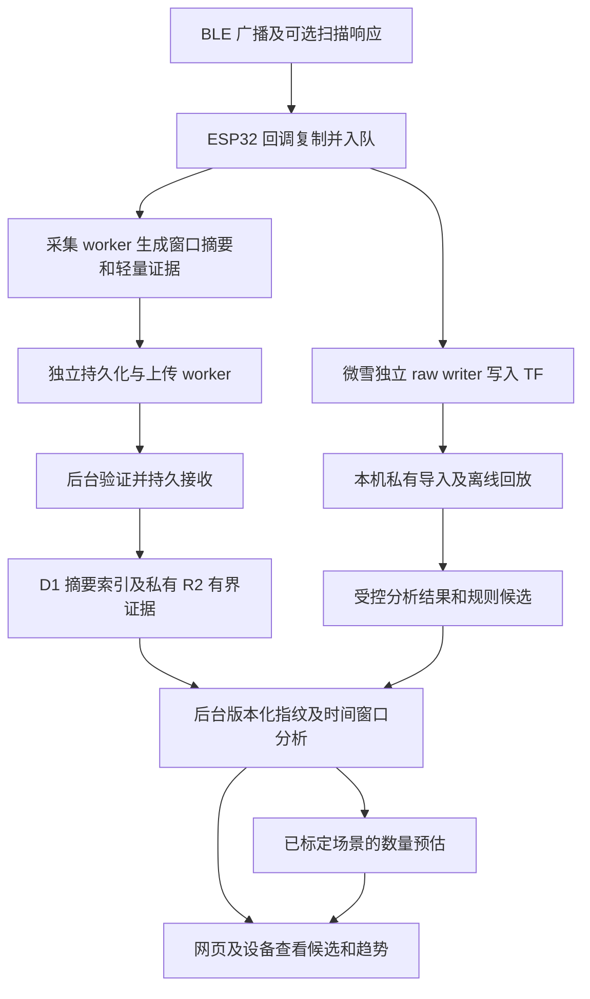

# BLE 设备识别与数量预估的端云分工方案

日期：2026-10-30。状态：**设计提案，分类扩展与总量模型待实现和标定。**

首版采用“ESP32 采集并生成有界证据，后台识别并计算趋势，经过现场标定后再估计总量”的分工。先覆盖部分手机及一两个电瓶车、汽车协议家族；证据不足的保留未知。固件可以显示轻量候选结果，但后台保存的版本化结果作为统一解释来源。

相关文档：[roadmap](ROADMAP.md)、[设备 v2 契约](../specs/device-v2.md)、[自动观察现状](../specs/automatic-observations.md)、[上传与持久回执](../specs/ingest-v1.md)、[固件平台](firmware-platform.md)、[复用记录](../notes/reuse.md)。

## 1 目标和输出单位

| 输出 | 首版目标 | 对外单位与边界 |
| --- | --- | --- |
| 手机 | 优先减少把耳机、手表、平板认成手机的误判；逐步扩充协议覆盖 | 手机相关候选标识；有独立标定后才提供手机数量估计 |
| 电瓶车 | 先覆盖一两个经过样本验证的品牌或控制器方案家族 | 已识别候选标识、品牌或方案家族趋势；校准后提供总量区间 |
| 汽车 | 先覆盖部分明确汽车协议或品牌线索 | 汽车相关候选；区分车端、手机钥匙和独立钥匙的角色 |
| 区域热度 | 比较同一固定点、同一采集配置下的相对 BLE 活跃程度 | 活跃度指数或等级；不直接换算人数 |

将三种信息分别保存：**收到的观测、规则推断的类别、模型估计的数量**。一个地址可能对应手机、耳机、车辆控制器或其他模块；同一车辆也可能有多个广播模块。首次检出、连续共现和真实到达分别定义。

品牌覆盖不完整仍能提供有用趋势。提高手机分类的精确率可以接受更多未知，但不能据此承诺接收所有手机，或把手机候选数当作人数。

## 2 当前已有能力与缺口

以下为本机代码和离线试验的现状，不代表所有板卡或生产链路已完成验收。

| 能力 | 当前状态 | 本方案需要补的部分 |
| --- | --- | --- |
| 微雪 TF raw | 独立固件保存传统及扩展广播报告、时间锚点、分片状态与采集计数；当前走本地 TF | 私有导入工具、版本化特征和分析结果；上传另行接入 |
| 生产采集摘要 | `cp_collect` 已按地址和类型聚合，包含计数时间桶与窗口级 RSSI | 更丰富的协议特征；当前摘要不能恢复逐桶 RSSI 或完整广播内容 |
| 固件车辆证据 | `cp_vehicle` 已记录名称、排除和经验模块掩码；每地址字段本体为 16 字节 | 支持新协议家族、来源与版本；现有掩码不包含完整 OUI、UUID 和报文模板 |
| 后台车辆候选 | `worker/vehicle-rules.ts` 和 `worker/place-inference.ts` 已有实验分类和公开投影 | 手机细分、协议家族指纹、时序指标、校准模型及新的结果接口 |
| ChimeraBLE | 固定提交的原始 C++ 已本机离线回放 602,315 条报告；其中停车三分钟为 20,774 条、257 个地址键 | 通用输出与产品类别映射、国内车辆规则、后台运行适配 |

当前 `cp_vehicle_observe` 和线上 raw `legacy_ad` 契约均以最多 31 字节为边界；TF 记录的扩展广播不能截断后冒充完整 legacy 数据。线上 v2 验证器当前允许至多 512 地址的配置，设备按自身容量接受或拒绝；现有公开车辆投影仍有 64 地址的输入门槛。接入新推断前须分别解决这些边界，不能仅提高一个常量。

ChimeraBLE 的非 `unknown` 输出包括公司名、保留编号和通用服务；输出没有原生置信分数。离线试验只证明该模块能够处理这些输入，不能作为车辆识别准确率。

## 3 总体数据流



TF 路径用于当前研究；生产路径沿用既有持久接收和独立回执。后台先保证原始输入按契约保存，再执行可重试、可重算的派生计算。分类失败不改变已成功的接收回执，设备也不以“分类完成”作为释放上传缓存的条件。

## 4 ESP32 和后台的职责

| 工作 | ESP32 | 后台和离线工具 |
| --- | --- | --- |
| BLE 接收 | 配置扫描，复制 SDK 报告，保留 ADV 与 SCAN_RSP 类型 | 根据实际配置解释可见性，不补造未采集响应 |
| 时间和质量 | 序号、单调时间、UTC 锚点及不确定度；队列、表满和存储损失 | 验证来源和窗口，分辨缺测、正常零观测、抽样及补传 |
| 广播解析 | worker 中做有界 AD 解析和固定版本特征提取 | 完整协议字典、型号规则、字段冲突与未知处理 |
| 厂商归属 | 可选缓存少量已验证供应商提示 | 更新 IEEE 分配表，区分公开地址和随机地址；保留注册版本 |
| 地址摘要 | 窗口内按地址加类型计数、分桶、汇总 RSSI | 在获准作用域内形成时间序列；不同地址默认分别统计 |
| 本地识别 | 可选的小规则集，供屏幕提示和调试 | 统一的协议家族和手机、电瓶车、汽车类别推断 |
| 热度和时间变化 | 保存计算所需输入；可显示短期本地观测 | 平滑、稳定共现、窗口变化与质量门禁 |
| 品牌覆盖和总量估计 | 保存采集配置和场景标识 | 现场样本标定、误差区间、模型选择及失效判定 |
| 字典和规则升级 | 读取经过版本验证的配置；保留生效边界 | 管理规则、字典、校准版本及历史重算 |
| 展示 | 显示来源、观测时间、有效性和离线状态 | 提供已识别候选、未知、冲突、趋势和可用的估计区间 |

### 4.1 固件实现约束

BLE 回调只做计数、必要的元数据复制和非阻塞入队。AD 遍历、名称匹配、特征累计放在采集 worker；写盘、序列化、联网和屏幕刷新使用各自任务。队列或表容量不足必须计数，不能通过不记录新地址来维持好看的曲线。

现有 16 字节证据结构在 128 地址时字段本体约 2 KiB，在 512 地址时约 8 KiB；这些数字不含地址表、时间桶、双缓冲、队列、网络和显示开销。先用实际布局与板卡测试定预算，不把主机编译通过视为固件有足够余量。

少量名称、UUID、固定前缀和位域规则适合 ESP32。完整 OUI 库、大量型号字典、现场回归模型及历史查询先放后台。若后续下放规则，优先使用有界表和固定大小状态，避免每包分配字符串或遍历大字典，并用同一批输入验证端云输出的一致性。

微雪独立记录器继续保留原 raw。给它增加 worker 分析时，应通过独立有界消费路径取得报告，不让 UI 或分类阻塞写入，也不能让两个消费者争抢同一条记录队列。

### 4.2 后台运行方式

沿用 Cloudflare：Workers 运行有界解析、规则和查询；D1 保存摘要索引、规则元数据、标定记录和推断结果；私有 R2 保存获准的有界 raw 与研究产物。大批回放和标定先在本机离线运行，验证后的轻量计算再接入后台。

本机试验的 macOS C++ 动态库不能直接部署到 Workers。线上首版优先复用 TypeScript 规则及解码逻辑，用固定回放验证与参考实现的差异；需要保留同源 C++ 时，再独立评估 WebAssembly 构建、运行预算和依赖许可。D1 以窗口摘要和有界派生记录为主，不为每个重复广播写一行；获准原始字节使用 TF 或私有对象归档。

首版按新接收窗口或明确时间范围计算，结果按输入引用与规则版本幂等保存。批次重试、迟到摘要和回放不能重复累加计数；不能在一次上传请求中扫描全部历史，也不能用 Worker 进程内可变表承担长期状态。计算失败保留待处理记录和原因。

需要自动重试时，再选择持久任务触发机制。`waitUntil` 只适合有界的响应后工作，不单独承担必须完成的任务队列。本设计不把 Queues、Durable Objects 或新迁移服务写成已经部署的依赖。

## 5 数据接口设计

先复用当前窗口、地址摘要、状态和有界 raw 流。新指纹特征作为独立版本提案冻结后再实现；现行 validator 严格校验字段，不能直接向已有请求塞入未定义字段。

| 信息 | 首版来源 | 作用与缺失处理 |
| --- | --- | --- |
| node、boot、placement、config、dataset、窗口和序号 | 现有信封与记录 | 精确定位输入，分离 field、demo、移动研究和固定点生产数据 |
| 单调时间、UTC、clock epoch、不确定度 | 设备观测与锚点 | UTC 未知保留未知；补传不更新成当前热度 |
| 地址与类型或明确作用域的关联键 | 获准的现有身份方案 | 默认不跨换址合并；不能延长 token 作用域来偷偷恢复关联 |
| ADV 与 SCAN_RSP 数量、首末偏移、计数桶 | 现有 v2 地址摘要 | 同地址两类报告不计为两个目标；空桶同时检查扫描覆盖 |
| 窗口级 RSSI 样本数与摘要 | 现有 v2 地址摘要 | 可做粗粒度权重；无法恢复精确中位数或逐桶 RSSI |
| 原始 AD 与记录格式 | TF raw；线上获准的 legacy raw | 长度与完整性分开验证；线上现行字段最多 31 字节 |
| PHY 与分片状态 | TF raw 已保留；当前线上 legacy raw 没有这些字段 | 单独设计版本扩展；缺失不等于 1M PHY 或完整状态，扩展片段不按完整广播解析 |
| 名称模式、服务与厂商特征、Appearance、模板 | 已有掩码加未来版本化特征 | 缺失与空集合分开；仅有掩码不能重新构造完整 Chimera 输入 |
| 扫描模式、重复过滤、有效扫描时间及损失 | 配置与状态 | 解释接收概率变化，决定是否允许外推 |

新特征提案至少区分：特征 schema、提取器版本、字典版本、命中的公共规则 ID、字段冲突与解析质量。特征应从明确的“全部进入 worker 的报告”或注明的样本生成，不能把每百包一条的 raw 样本当作全量分类覆盖。

原始名称、地址、载荷和可关联键保持私有。模板中屏蔽 MAC 回显、序列号、计数器等个体字段，只保留归类所需结构；模板相似不建立跨地址个体关联。新特征方案需明确容量、截断与溢出语义，并保留一小部分获准 raw 作对照。丢弃了的内容无法在后台恢复，因此不能只传三个最终类别数字。

当前 OUI 查询只对公开地址使用分配表，查到的是地址分配方。芯片厂、模组厂、控制器方案商与整机品牌可以不同；随机地址不强行查 OUI。短时关联和原始证据沿用现有权限、保留期限与清理机制，派生的私有关联数据也要按引用关系过期。

## 6 后台识别流程

1. **验证输入。** 核对配置、窗口、序号、时间、采样、容量和质量；损坏或不完整报告保留其质量标记。
2. **提取协议特征。** 解析 AD 类型、长度、UUID、厂商字段、Appearance、名称模式和固定前缀；反复出现的字段保留冲突来源。
3. **匹配指纹。** 参考 ChimeraBLE、Theengs 和 AirGuard 的公开方法，先识别协议与供应商，再推断设备类别。保存原样标签与解释规则，避免把字典命中当作身份认证。
4. **形成窗口结果。** 对地址加类型的观测汇总命中与冲突；保留一个地址在不同报告中出现的多个标签，不靠多数票强行变成物理类别。
5. **计算趋势与估计。** 先产出候选与活跃度；只有通过场景校准与质量门禁，才计算总量区间。

结果至少区分 `phone_related`、`e_bike_related`、`car_related`、`other` 和 `unknown`，另设独立的 `conflicting` 状态；这些是提案语义，不是已发布 API 枚举。协议家族、OUI 分配方、终端品牌和可能角色分别保存。耳机、标签、手机钥匙与车辆模块可以使用相同生态协议。

证据等级用“明确协议或型号线索、品牌或方案相关线索、未知或冲突”表达，不凭规则数量生成伪概率。若采用 Chimera 原始输出，明确其没有置信分数、最多显示三标签和宽松解析等边界。`FindMy` 标签不直接变成 AirTag，Apple 厂商编号不直接变成手机，HID 也不直接排除所有车辆相关设备。

手机首版侧重精确率：组合协议、型号或 Phone 声明，利用已知耳机、手表、平板反例测试；单一厂商编号不足时保留未知。车辆先选有样本依据的一两个家族，再扩充。`TL_` 名称、车辆方案商 OUI 和匹配结构可以组合成较强候选；仅共享 `0x0020` 不自动继承该类别。

## 7 计数 热度与时序

### 7.1 候选计数

窗口内的基本单位仍是地址加类型。一个窗口多条广播只贡献一个相应候选标识；同地址的广播与扫描响应合并证据，但分别保留报告计数。相同载荷哈希不用于跨地址去重，一车多模块也不凭 RSSI 相似度合并。

多个接收器覆盖重叠时，首版为每个统计点选择一个主接收器，其他节点作对照；不将它们的地址数直接相加。按品牌分别外推后，每个结果都在估计同一总量，不能再次相加。跨节点融合和车辆级模块去重属于后续独立验证工作。

### 7.2 相对热度

首版并列保留窗口内可见地址数、分类候选数和独立的广播报告速率。主热度基线限制每地址在一个统计窗口中的贡献，再比较有无 RSSI 权重的结果，避免高频广播支配指标。

离线 raw 可比较 10 秒桶、30 秒与 60 秒窗口及因果 EMA；这些是待标定参数，不改变现网配置。生产 MVP 先使用现有计数桶与窗口级 RSSI。若要复现逐桶中位数权重，必须增加经过资源验证的 RSSI 子桶、直方图或其他明确近似的契约，不能由均值伪造中位数。

分别记录最近可见、检出桶覆盖率、最大接收间隔和短时重现。首末检出相隔三分钟不等于连续驻留三分钟；连续未收到可能来自离开、休眠、漏收、地址轮换或采集空窗。平滑改善的是波动与响应延迟之间的取舍，不是分类准确率。

固定点、便携步行、主动扫描和不同扫描配置分别评估。移动采集适合发现协议与检查接收变化，不直接校准固定点人数或停车占用。

## 8 从部分品牌推算总量

只有在“一车约一个有效计数目标、误报受控”的简化条件下，才可写成：

```text
估计总量 ≈ 该品牌有效候选数 / 该品牌现场占比 / 综合可检出率
```

综合可检出率包含支持相应蓝牙功能、当时是否广播、无线接收和分类召回。全国销量份额不能直接替代校园停车点的存量品牌占比。锁车、休眠、接收器朝向、停车密度和主动扫描模式变化，都可能改变有效覆盖。

低投入首版优先使用现场计数拟合有效覆盖关系：

```text
C ≈ κ × N + b
N_hat = max(0, C - b) / κ
```

其中 `C` 是同一定义下的候选标识数，`N` 是同一空间范围和时段内的人工车辆数，`κ` 是该场景下平均每辆车贡献的有效候选数，`b` 是背景或误报项。`κ` 可以包含品牌份额、可见性和模块数的影响，因此不是必须小于 1 的纯概率。无法从数据分别识别这些因素时，不将其包装成已测品牌份额或检出率。

几轮固定点人工计数先建立基线，增加不同日期、密度和车辆状态后，在独立趟次上评估误差和区间覆盖。手机分类另有已知设备样本，不能拿车辆标定系数推算手机或人数。

标定样本需要覆盖变化的人工总数，并用空场或其他明确背景对照估计 `b`；一次固定数量的观察无法同时辨识 `κ` 和 `b`。若首版暂设 `b=0`，须记录为待验证假设。`κ` 必须有正且稳定的估计范围；覆盖极低、区间包含零或参数不可辨识时不做除法外推，返回空估计。模型同时限定已验证的车辆数量和密度范围，超出范围不靠截断负值或延长直线继续输出总量。

手机和车辆的分类精确率按人工确认的设备样本定义，不按重复广播报告计算。同一已知物理设备的重复记录不跨开发与验收集合；在此基础上再按趟次或日期留出，需要评估新型号时另做型号留出。分类未知比例、收到报告后的识别覆盖率，以及已知在场设备的漏检分别报告，避免用更多未知掩盖覆盖下降。

“至少二十辆”这样的现场说明作为总量下界标签保存，不能当作精确 `N=20` 拟合系数；未逐台确认归属时也不能计算品牌识别 precision 或 recall。分类验证用已知设备，外推验证用同场景人工总数，两者分别验收。

没有有效标定时，`estimated_total` 保持空值，继续显示候选数和趋势；模型失配、表满、严重缺测或扫描配置改变时暂停外推。有效标定也输出预测区间、适用场景和原始候选数。区间宽度由独立的区间标定集确定，最终覆盖率在另一批留出的趟次或日期上验收；不能用同一批误差定宽后再宣称覆盖达标，也不编造固定百分比。完整窗口里的零候选也不自动意味着零辆车。

## 9 结果与版本管理

后台派生结果保留输入窗口和批次引用、观测时间、不确定度、计算时间、有效期、输入 schema、提取器、指纹规则、字典及校准版本。重新计算产生新版本，不改写设备原始记录或人工标签。

展示字段至少包括：各类候选标识数、未知与冲突数、覆盖和损失标记、相对活跃度、可用的估计区间、模型适用范围及不可用原因。候选、模型总量和人工观察采用不同单位；不把“无数据”“旧结果”“零候选”和“估计为零”合并。

端上本地提示带自身规则版本，后台结果带后台版本。设备离线时可以展示本地候选或最后一次后台结果，但要保留其来源和原始时间；不能把上次估计刷新成当前值。

## 10 分阶段实施与验收

| 阶段 | 主要改动 | 完成条件 |
| --- | --- | --- |
| P0 离线分类基线 | 复用已有 CPRAW 解码和 Chimera 主机回放；定义类别、角色、证据等级与未知 | 报告和地址统计守恒；原样标签与产品类别分栏；已知设备样本能定位误判规则 |
| P1 小范围候选服务 | 后台复用车辆规则，补手机和选定车辆家族；冻结所需输入扩展与派生结果契约 | 旧设备/旧批次兼容；缺字段明确不可用；指纹可追溯、可回放；解决 31 字节和 64 地址路径边界 |
| P1 固定点趋势与标定 | 保持单点采集配置，人工记录车辆数与已知设备状态，计算候选趋势和有效覆盖基线 | 按趟次或日期留出验证；分别报告分类精确率/召回率、总量误差、区间覆盖与可用率 |
| P2 稳定规则下放 | 在采集 worker 增加有界规则或特征；必要时扩充 RSSI 摘要 | 同源回放端云一致；实板并发采集/写盘/上传时的内存、延迟和损失通过预算 |
| P3 主动和多节点研究 | 已知样本做主动扫描、GATT/HCI 对照，必要时专用 sniffer | 新增信息与扫描空窗分别可量化；主动响应不抬高被动热度；多节点不重复计数 |

优先级是本方向的实施顺序，与整体 roadmap 一起排期。首版采用已有规则、字段和少量家族扩展，先取得可解释的候选与趋势；细粒度定位、跨换址个体关联和大型学习模型不作为初版前提。

每轮上线前至少检查：固定源码/字典版本，正常与重复批次，空窗口，未知 UTC，部分窗口，迟到记录，截断 AD 与扩展片段，身份作用域边界，表满/丢包，多个接收器重叠，模型缺失/过期，以及源证据过期后的私有派生清理。所有阶段把主机测试、现场识别验证和固件资源验证分别记录。

## 11 实现入口与参考

已有入口：[`cp_vehicle`](../../firmware/components/cp_vehicle/include/cp_vehicle.h)、[`cp_collect`](../../firmware/components/cp_collect/include/cp_collect.h)、[设备验证器](../../worker/device-v2-validation.ts)、[raw 验证器](../../worker/ingest-validation.ts)、[车辆规则](../../worker/vehicle-rules.ts)、[公开候选投影](../../worker/place-inference.ts)、[微雪记录格式](../../firmware/waveshare-raw/FORMAT.md)。

方法参考：

- [ChimeraBLE 固定源码](https://github.com/MatthewKuKanich/ChimeraBLE/tree/2330423dae8f8fa163617172310784889d8972a7)：原始广播指纹基线；本地回放不自动成为产品依赖。
- [Theengs Decoder 规则设计](https://decoder.theengs.io/participate/adding-decoders.html)：按结构、前缀、长度、位域与型号表解码。
- [ESPresense 指纹与查询](https://espresense.com/configuration/settings/)：[原始实现](https://github.com/ESPresense/ESPresense/blob/5770128b378a82e0cef42d8515dc541c738a5344/main/BleFingerprint.cpp)区分广播指纹与可选 GATT 查询。
- [AirGuard 设备规则](https://github.com/seemoo-lab/AirGuard/tree/main/app/src/main/java/de/seemoo/at_tracking_detection/database/models/device/types)：查找网络特征与状态，不直接等于物品类别。
- [Cloudflare 存储分工](https://developers.cloudflare.com/workers/platform/storage-options/)与[响应后工作](https://developers.cloudflare.com/workers/runtime-apis/context/)：实现时按实际计算预算选择持久处理方式。

ChimeraBLE 所选源码标注 GPL-3.0-or-later，其他项目条款各自核对。实际复用代码时在复用记录中保存来源、版本、许可和修改范围，并核对产品分发方式；本机回放与产品集成分别记录依赖范围。
