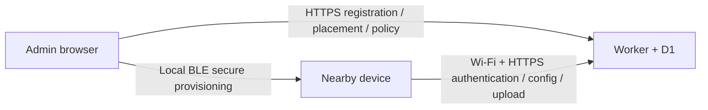

# Firmware platform, onboarding and local interaction

> **Partially superseded, 2026-10-29:** Bluetooth and device-hotspot setup are
> retired. Current onboarding is [USB only](../notes/usb-only-provisioning.md);
> the wireless setup and iOS fallback descriptions below are historical.

Dates: 2026-10-24–2026-10-25. Status: **partially implemented platform design**. The
Passport local software chain now implements protected browser BLE / device-hosted
SoftAP onboarding, settings, policy control, canonical summaries, a Flash journal
and upload receipts; final native, local Worker, mock-browser and four-variant C3
image checks pass. See [current implementation and evidence](../notes/firmware-chain.md).
Physical hardware acceptance, S3 support, USB provisioning, durable manual markers
and ePaper interaction remain pending. No device has been flashed by this work.

[Stage A](../notes/firmware-runtime.md) is retained as a historical intermediate
snapshot. The implementation below is distinguished from still-proposed extensions;
passing native/browser/build checks does not satisfy the physical acceptance column.
For iOS the implemented fallback is the device-hosted SoftAP page; its exact HTML
passes a WebKit fixture test, while an iPhone-to-board hotspot session remains untested.

Related: [firmware baseline](../notes/firmware-baseline.md),
[roadmap](ROADMAP.md), [ingest v1](../specs/ingest-v1.md),
[admin API](../specs/admin-v1.md), [manual API](../specs/web-api-v0.md).

## 1. Original import observations (historical)

These observations describe the pre-refactor import, not current platform ownership.
The [current component table](../notes/firmware-chain.md#implemented-path-and-ownership)
records the implemented replacements.

| Imported source | Behavior at import | Consequence for the shared collector |
| --- | --- | --- |
| `firmware/ai-passport-radar/main/main.c` | Initializes Passport I2C, LCD, battery and buttons; returns on display/input failure | Optional UI must not gate a working collector |
| `main/page_radar.c` | Starts BLE in `radar_page_start()`; modifies scan/classification switches and resets tables; periodically requests saves | A page must observe services, not own scanner, storage or policy lifecycle |
| `main/scan_ble.c` | Owns NimBLE; parses/classifies inside its callback and drops some repeated reports before table processing | New report counters/address summaries need their own callback-to-worker path before diagnostic filtering |
| `main/scan_ble.c`, `scan_ble_snapshot()` | Advances prune/dwell/confirmation state while the UI reads a snapshot | A collector worker must own periodic time advancement; a snapshot read should have no side effects |
| `main/scan_table.c` | Drops address type from the key and can merge different addresses using a short payload fingerprint | Keep this as inherited diagnostic logic; canonical address summaries must retain MAC plus address type and must not perform this merge |
| `main/wifi_time.c` | Optional compile-time Wi-Fi header; connects for SNTP and then stops/deinitializes Wi-Fi | Replace its driver ownership with one persistent network service shared by setup, clock and upload |
| `main/ui_mini.*` | Passport-specific 240×320 RGB565 band rendering, two 240×16 buffers | Reuse the small renderer on Passport; ePaper shares semantic state, not pixels or refresh timing |
| `components/bsp/CMakeLists.txt` | Links display/LVGL/audio/battery components together | Select board features at build time; keep unused audio uninitialized and unnecessary drivers out of headless builds |
| `worker/admin.ts` | Registers nodes and reveals a unique bearer once; manages placements and desired policies | Reuse these cloud operations for the first five devices |
| `worker/ingest.ts` | Authenticated configuration fetch and applied/failed reports | Firmware must implement the client, validation, application and recovery; these server routes do not establish hardware support |

At import, default-off calibration exports/NVS access were a local safeguard,
not a durable upload journal. The original imported layout had no application
queue partition. The local chain now declares `cpqueue` at `0x360000` / `0x400000`,
with unknown bytes quarantined rather than formatted. Any partition-table write
still needs a separate physical device-layout review; do not assume unused Flash is empty or writable.

## 2. Three layers, one application

Use shared ESP-IDF components and compile-time board selection. Do not introduce
a universal hardware framework or runtime pin autodetection for three known
board families.

| Layer | Owns | Does not depend on |
| --- | --- | --- |
| `cp_core` | Lifecycle decisions, policy validation, aggregation, immutable records, marker state machines and observable status | BSP pins, display dimensions, LVGL, NimBLE or HTTP handles |
| `cp_esp` | FreeRTOS tasks/queues, singleton NimBLE ownership, Wi-Fi, HTTPS, NVS/journal access, monotonic/UTC clock and random IDs | A particular screen, button layout or board's protected partition offsets |
| Board adapter and optional UI | Verified pins/drivers, power/battery capabilities, input mapping and rendering | Direct cloud authentication decisions or ownership of collection/upload |

Keep the existing C3 project as the first build entry while extracting components
into `firmware/components/`. Register them with `EXTRA_COMPONENT_DIRS`. Once a
second verified target works, consolidate the small launcher into one application
entry; avoid a wholesale tree move at the same time as changing protocol logic.

Component ownership was implemented under `firmware/components/`; the current
modules are listed in the [chain note](../notes/firmware-chain.md). The following
longer-term target tree, including other board families, remains a proposal:

```text
firmware/components/cp_core/       lifecycle, policy, aggregation, marker logic
firmware/components/cp_esp/        radio/network/clock/storage/HTTPS workers
firmware/boards/passport/          existing C3 BSP adapter + Passport UI
firmware/boards/tenergy_s3/        pending verified revision and driver mapping
firmware/boards/waveshare_epaper/  pending exact panel/board verification
firmware/targets/<board>/          explicit sdkconfig, partition and budget files
firmware/tests/                   host logic and image/layout checks
```

This is a target structure, not a list of already supported boards. Each build
selects exactly one board/revision. A profile records capabilities, known memory
budgets, optional input/display/battery, and partitions available to the app.
Firmware-declared capabilities help reject impossible configurations but do not
replace hardware revision verification. Unknown boards must not inherit Passport
pins or its protected layout. Optional sensor values stay unavailable when the
hardware cannot measure them.

The board-facing interface should expose a few semantic operations: initialize,
read optional power state, enqueue timestamped input, and present a status/view
model. Keep SPI/I2C/ePaper implementation details in the adapter. Services receive
commands through queues and publish bounded snapshots; they do not draw screens.

### Task ownership

- One BLE lifecycle owner switches between provisioning and observation. The
  discovery callback assigns a sequence, captures time, copies a bounded report
  into a queue and returns; overflow is counted. Copy before the stack's payload
  buffer expires. No TLS, Flash writes or formatted per-packet logs there.
- One collector worker owns counters/address tables, time bins and periodic
  ticks even with no packets or no UI. Preserve MAC plus address type before raw
  sampling. Address-table exhaustion and ingress loss are separately visible.
- Storage and network/upload workers own slow operations, retry and reclamation.
  Reserve capacity for window/status/manual/control records; raw samples cannot
  consume every byte or scheduling opportunity.
- One UI task processes input events and renders snapshots. Timestamp a button
  event at ingress so queue/render delays do not inflate measured waits.

Display failure is a degraded UI state; collection can continue if its essential
dependencies and policy are valid. Failed durable storage cannot be reported as
a successful local save. Local emergency pause is always available; UI controls
must not silently enable a stream or scan mode that the active policy forbids.

## 3. Administrator-panel Web Bluetooth setup

### Browser and device roles

The HTTPS administrator page uses `navigator.bluetooth` to communicate directly
with a nearby device's BLE GATT service. It also calls the normal same-origin
admin API. Cloudflare never connects to the computer's Bluetooth adapter.



Supported acceptance targets are Chrome/Edge on suitable desktop platforms and
Chrome on Android. Safari, including ordinary iPhone Safari, is not a native
Web Bluetooth target. Feature detection, browser permission, OS permission and
an actual adapter connection must all succeed. A PWA wrapper does not create
missing browser support. The current embedded Codex browser is not assumed to
provide hardware access.

The Connect button must invoke `requestDevice()` directly from a user gesture;
do not first await a cloud login/registration request and lose transient user
activation. Use a known provisioning service filter and grant only its required
services. A browser's `BluetoothDevice.id` is an opaque browser identifier, not
the device's MAC or CampusPulse node ID. Read the factory-derived node ID from
the device protocol and confirm it after establishing the provisioning session.

Prefer ESP-IDF 5.5.3's supported `wifi_provisioning`/`protocomm` protocol and its
NimBLE transport instead of inventing a plaintext GATT credential characteristic.
The web client still needs the matching protobuf protocol and secure-session
implementation. No working official browser SDK or encrypted end-to-end client
is claimed by this design. Select and pin a supported secure mode only after
web/firmware conformance tests; do not downgrade to Security 0 because an npm
wrapper lacks its cryptographic handshake. Any third-party code requires review
and reuse attribution before adoption.

The current administrator CSP already limits network connections to the same
origin; GATT traffic is handled by the browser hardware API rather than a fetch
to the device. Keep setup UI and cryptographic client code self-hosted. Check the
`bluetooth` Permissions Policy and top-level secure context explicitly during
implementation; do not loosen unrelated CSP protections.

Standard Wi-Fi provisioning does not carry CampusPulse enrollment data. Define
one versioned application-specific endpoint inside the same protected session
for factory identity, assigned node ID, cloud bearer delivery, provisioning
attempt ID and durable-state/status queries. Bound message sizes and retries;
verify that automatic provisioning shutdown cannot discard its final write or
confirmation. The local implementation now defines these messages and UUIDs in
[`cp_provision`](../../firmware/components/cp_provision/README.md). A received reply
is RAM acceptance; save follows network/cloud validation and a controlled reboot.

Use per-device provisioning proof of possession distinct from the node MAC and
cloud bearer. Passport can display the setup proof; headless boards need a
verified button/USB preparation or separately delivered setup proof. Proximity,
an advertisement name or a MAC alone does not authorize credential replacement.
Setup mode has a bounded lifetime and a clear local entry/recovery action.

### First-device workflow

1. User opens **Devices → 连接并部署设备** and explicitly enters setup mode
   on the device. The browser selects the service and establishes a protected session before
   trusting factory identity. The first implementation reports the Passport
   board family; physical board revision still needs independent verification.
2. After possession verification, read the factory node ID. The administrator confirms
   the physical device and name. New IDs use all twelve lowercase hex digits
   from the factory eFuse base MAC, with one stable project prefix. Existing
   database node IDs remain unchanged; IDs are immutable and referenced by old
   evidence. Interface/random BLE addresses are not the identity source.
   This first implementation only enrolls factory-derived IDs. Migrating a
   legacy arbitrary logical ID needs an explicit binding design; the current
   registry has no such hardware-binding field. Do not automatically re-register
   legacy hardware under a new ID.
3. Register through existing `POST /api/v1/admin/devices` with fresh admin
   authentication. Its independent device bearer is shown once. If the cloud
   registration response is lost, do not blindly register again or silently
   rotate an existing device. Show the partial state and use an explicit recovery
   path; existing registration is not itself idempotent secret delivery.
4. The browser sends the bearer and selected Wi-Fi profile to that device over
   the protected BLE session. Wi-Fi credentials stay on the browser/device path,
   outside cloud registration payloads, analytics and logs. Device credentials
   originate in the cloud but stay only in transient browser memory before
   delivery. Never send the admin/operator/research credential to a collector.
5. Device validates and stages candidate settings with a provisioning attempt
   ID. Distinguish GATT received, durably stored, Wi-Fi IP obtained, HTTPS device
   authentication and configuration activation. Preserve previous working
   settings on failed reprovisioning; do not clear pending observations.
   This can restore Wi-Fi but cannot undo cloud revocation: current credential
   rotation immediately invalidates the old bearer. A BLE disconnect or browser
   refresh after registration/rotation may require explicit delivery recovery
   or another authorized rotation; the server cannot recover a lost secret.
6. The administrator assigns a placement and publishes a compatible policy.
   While setup is active, the device may fetch, validate and stage it without
   starting observation. A registered device with valid networking may correctly
   wait for a placement/configuration.
7. Confirm durable provisioning state, then close provisioning or perform a
   controlled reboot and hand BLE ownership to the normal application. Only
   after applying the staged policy may it start authorized observation and
   report activation. Pending records/settings survive this handoff. The browser
   wizard follows later cloud application reports independently of the original
   GATT connection; current historical ACKs are not proof this attempt completed.
   Device v2 now binds contact and activation to a boot and increasing sequence.
   The wizard checks fresh contact and the current desired/applied config. It does
   not claim a server-persisted provisioning-attempt ID or physical acceptance.

There are three distinct facts to display: **registered**, **network/cloud
reachable**, **policy applied**. The implemented v2 contact route reports a
connected but unassigned node without fabricating a sensor upload. Admin
`latest_control`, `desired_config_id` and current-boot `applied_config_id` preserve
these boundaries; a configuration GET by itself is not a contact receipt.

### Wi-Fi ownership and recovery

One network service owns driver initialization, stored profiles, connection,
backoff, SNTP and HTTPS availability. Replace the current connect-for-time-only
`wifi_time` owner; its display helper can read the shared clock service.
Initially accept one tested WPA2-Personal profile. Design the profile store for
Enterprise PEAP credentials, identity and server validation; do not pretend an
SSID/password-only form supports the campus network. ESP-IDF supports Enterprise
methods, but the standard provisioning messages and our UI need explicit fields
and acceptance for them.

Choose explicit Wi-Fi RAM driver storage plus one application-managed, versioned
NVS settings record to avoid duplicate hidden credential copies. Ordinary NVS
is not an encryption-at-rest guarantee. Use commit/recovery semantics and avoid
erasing a whole partition on initialization failure. Preserve `cardid` and all
unacknowledged data. Wi-Fi reset, cloud unbinding, local-display reset and queue
reclamation are different operations.

BLE setup and radio observation run in distinct modes for the first release.
Opening setup seals the current window and records a scan gap. Both provisioning
and the inherited scanner currently want NimBLE ownership: do not initialize two
hosts or blindly use a provisioning sample's FREE_BTDM/FREE_BLE handlers when
later observation needs BLE. Verify stop/restart/deinit against the pinned IDF;
do not infer concurrent performance from separate passing builds.

Local SoftAP web setup is implemented into the shared settings validation/storage
path. The [short PIN and USB revision](../specs/local-provisioning-v2.md) adds
physical USB setup for headless nodes and replaces the original displayed long
proof; its software and hardware acceptance are recorded separately. SoftAP uses a bounded session and a per-device
secret. Its local page is served by the device; do not weaken the cloud admin
CSP or try to fetch arbitrary HTTP LAN endpoints from the HTTPS admin page.
The embedded page has a WebKit fixture pass; target-phone and board hotspot
acceptance are still required.

## 4. Fetching and applying capture policy

```text
boot → recover local records/settings → need setup OR connect network
     → establish usable clock and verified HTTPS
     → authenticate device → wait for assignment OR validate desired policy
     → stage policy → apply at a window boundary → mark same-boot applied state
     → report applied/failed → collect and upload with independent receipts
```

These are lifecycle facts, not one combined enum that assumes Wi-Fi, upload and
collection always fail together. Track enrollment, network, clock, active/desired
policy, collection, queue and UI health independently in the status snapshot.

Use the implemented `GET /api/v2/device/config` for v2 desired policy, and its explicit ID
lookup only for old queued-policy context. Validate node identity, protocol,
adapter, scan parameters, streams, address policy, dataset, placement and local
budget. Server limits can lower compiled safe limits; they cannot add missing
hardware or increase local allocation beyond its verified capacity.

Implemented policy order: validate desired response → stop and seal the old
window → apply new adapter/policy settings → mark applied in this boot → enqueue
activation report. Enrollment settings are durable; policy authorization is not
restored as an indefinite persisted grant. On failure, report a bounded machine reason and remain safely
paused or use an explicitly authorized previous policy; never silently report
`applied` after substituting unsupported behavior. Preserve old placement/config
IDs and frozen bytes on pending batches. A local location selection is a change
request until an authorized placement/policy boundary is established.

Implemented contract and remaining gaps:

- The v2 contract now carries address summaries, independent contact and
  current-boot activation. V1 remains separate and unchanged. Local-marker
  capabilities and terminal observations are still a future contract; the strict
  collector validator does not silently accept those fields.
- `accept_until` is the server's **upload acceptance cutoff**, not a collection
  lease. V2 defines an explicit control lease; the current wizard uses 120
  seconds. The firmware requires a fresh desired-policy fetch after boot and
  enforces the remaining same-boot monotonic lease. Only a successful desired-policy fetch renews it, not backlog upload
  or historical-config reads. Validate the chosen duration during throughput/field testing.
- Definitive authentication rejection stops new collection and retains evidence.
  Remote disable cannot instantly stop disconnected radio hardware; bounded
  offline authorization makes this delay explicit.
- Unknown/uncertain UTC stays unknown. Keep monotonic time for durations and
  clock epochs for corrections. Bootstrap plausible time without disabling TLS
  certificate verification. A reboot cannot revive an indefinite cached policy
  based only on an old timestamp.
- V2 activation reports now carry boot/apply sequence. The client freezes
  pending retry bytes; the server rejects changed bytes, stale sequences and
  retired boots. A new boot must contact and reapply/re-ACK rather than inherit
  an old applied state. Historical ACK does not prove the current boot is running.

## 5. Passport display and local markers

Keep the current direct renderer initially. One UI task owns focus, model and
drawing; input and service tasks send events/snapshots. Stage A moved the inherited
shared input/render state to one UI owner. Durable manual workflows below remain
planned.
Use the same semantic status model for a headless status endpoint or ePaper's
slower card, without sharing Passport display geometry.

The current status page shows factory node/board, network, cloud authentication,
policy/collection status and local setup credentials while setup is active. A
future interaction view should also show location, exact policy version, pending
records, last durable confirmation and detailed quality problems.
An absent value is displayed as unavailable. Inherited phone/vehicle heuristics
belong on Diagnostics with their evidence limits, not as the main product truth.

Three-button navigation: UP/DOWN select or adjust; OK enter/confirm; every submenu
has Back. Put provisioning and diagnostic controls in explicit pages. Do not
reuse accidental double-OK as a hidden raw-log switch or repurpose the separate
physical power switch.

Local markers are proposed structured records, not resets of the BLE table:

| Action | Meaning and minimum retained context |
| --- | --- |
| Wait start/finish | Linked session events, node/boot/place/config, event mono/UTC/uncertainty and outcome; a completed wait can become an eligible manual sample |
| Wait abandon/cancel | Explicit abandoned, censored or cancelled outcome; never silently convert it to a completed wait |
| Parking observation | Manual minimum/maximum quantity and observation time/place; bounds are count uncertainty, not a duration |
| Experiment/bookmark | Bounded annotation code with session/stream/sequence/time references; separate from public manual observations |

For waits, start/finish timestamps are captured at input ingress. Navigating away
does not end timing. A reboot during a wait is interrupted unless continuity can
actually be established. Unknown UTC does not prevent a same-boot local duration,
but it may prevent a public timestamped observation.

Visible persistence states: **editing → saving → stored locally → waiting for
network/retry → cloud confirmed**. RAM acceptance is not durable save. Confirmed
means an identity-matching committed receipt, not a successful BLE write or
HTTP status alone. Keep a bounded recent-confirmation history after reclamation.
Preserve immutable IDs/bodies, pending cancellation and replacement links across
uncertain uploads; original and cancel intents may both need reconciliation.

Current `POST /api/v1/observations` only accepts parking bounds or completed
wait seconds under an independent operator credential; it has no start/end
events, experiment markers or terminal provenance. Add separately granted,
revocable terminal/manual capabilities before Passport cloud writes. Do not copy
the shared operator token to every collector or claim the historical marker
receiver is compatible with the current Worker. Records older than the existing
24-hour input horizon need explicit review/expiry handling, not a rewritten time.

## 6. Implementation order and acceptance

| Slice | Concrete result | Acceptance |
| --- | --- | --- |
| A: Lifecycle and board boundary | Current Passport entry launches collector independently of optional display/input; worker owns time ticks; one UI owner; board profile isolates pins/budgets | C3 build remains valid; host tests for no-packet expiry, no UI, display failure and policy gating; S3 support stays pending |
| B: Browser/device provisioning | Admin Connect wizard + protected GATT setup, factory identity and durable Wi-Fi/device credential settings; singleton network/BLE handoff | Supported real browser + one physical Passport; wrong proof, disconnect, cancelled permission, bad Wi-Fi, lost registration response and power-loss recovery |
| C: Policy control | Desired fetch, compatibility checks, staged application, activation retries and explicit bounded offline behavior | Reset during apply, unsupported policy, no assignment, revoked credentials, stale retry and place change keep correct state/provenance |
| D: Collection and upload | Versioned MAC/address summaries, overall windows/health, bounded raw evidence and durable per-stream journals/receipts | Reconcile acquired/aggregated/selected/dropped/confirmed counts under reset, full storage and 5-minute network interruption |
| E: Other-board collection | Verified T-Energy and exact Waveshare profiles/partitions/drivers; same core/protocol, collection first | Build and physical acceptance recorded for all five devices, then multi-node coexistence/clock tests; display features can remain absent |
| F: Local interaction and place displays | Durable Passport wait/parking/annotation records with scoped terminal authorization; optional ePaper status card | Input timing, cancel/correction, full queues, reboot during wait, and local/cloud status are correct while scanning/uploading; ePaper refresh does not dictate collector timing |

Slices A–D now have local software implementations, with current evidence in
[firmware chain](../notes/firmware-chain.md). Their physical acceptance remains
open; E–F are still planned. These are scoped slices, not a claim that adding board macros delivers all five
devices. Hardware acceptance and firmware builds remain separate. Do not add an
unverified S3 profile merely to make a support matrix look complete.

## 7. Sources and review boundary

The original source observations were checked against the imported runtime and
Worker/admin source on 2026-10-24 and are retained as historical context. No new driver, protocol library or code
from a neighboring/private repository was copied in this design review. No
runtime, API, upload format or administrator behavior was changed by the original
design review alone. Later implementation is recorded separately in the chain
note; the earlier C3 build evidence still applies only to its exact snapshot.

- [Chrome Web Bluetooth documentation](https://developer.chrome.com/docs/capabilities/bluetooth): secure contexts, user gesture, browser GATT access.
- [Web Bluetooth implementation status](https://github.com/whatwg/bluetooth/blob/main/implementation-status.md): platform/browser support; Safari is not a native target.
- [ESP-IDF 5.5.3 C3 provisioning](https://docs.espressif.com/projects/esp-idf/en/v5.5.3/esp32c3/api-reference/provisioning/wifi_provisioning.html): transports, protocomm sessions and BLE memory/lifecycle behavior. Local pinned source also selects `protocomm_nimble.c` for NimBLE builds.
- [ESP-IDF 5.5.3 C3 Wi-Fi security](https://docs.espressif.com/projects/esp-idf/en/v5.5.3/esp32c3/api-guides/wifi-security.html): Enterprise methods and required profile distinctions.

Do not copy official examples' credential logging or whole-Flash reset commands
into CampusPulse. Retain the baseline's provenance, protected partitions and
font-rights release gate during implementation.
