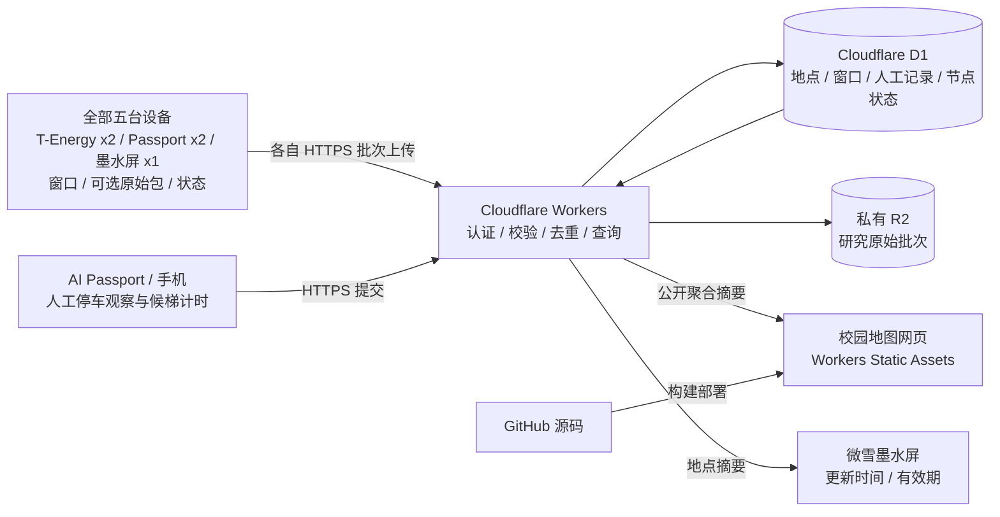

# CampusPulse 黑客松整体方案与 MVP

日期：2026-10-23（Asia/Shanghai），状态核对：2026-10-25。本文保留总体设计与
建议验收目标；网页与人工记录首版已部署，设备 API 已部署并完成隔离 demo 验证。
Passport 配网、v2 策略、BLE 聚合与持久上传已实现；一台 Passport 已更新应用并
验证启动与原生 USB，真实入网、现场采集上传和其他板卡验收仍须分别完成。
当前证据见[固件链路](../notes/firmware-chain.md)与[上传服务](../notes/backend-ingestion.md)，
不要将下文的目标和建议数字当作已完成结果。

**2026-10-25 交付方向：先呈现现场 API 的真实数据，下午实地采集后回看同一批
记录，保留独立模拟入口。** 最新可执行的准备、录制、回放与演示验收见
[黑客松交付清单](../notes/hackathon-delivery.md)。现场观察现在与保留的聚合历史
共用一条横向时间轴：实时端跟随现在，拖动或点击标记停在历史时刻，返回实时
继续观察。模拟演示仍单独选择；原有整日曲线与移动人物回放均为合成示意。

**2026-10-23 硬件决策：全部五台先实现采集、缓存和直接上传；AI Passport 再加
交互，墨水屏再加展示。** 本文已更新架构、实施顺序和验收，取代原先“一台
Passport 只录入、另一台专做信标、墨水屏只展示”的分工。

**2026-10-23 协议补充：** 用户要求支持 MAC 与广播载荷的研究上传。现行接口
提案见[上传协议 v1](../specs/ingest-v1.md)，增加私有 R2 原始批次归档；早期
“只在本地保留原始数据”的范围已由窗口／原始／状态三流设计取代，服务端现已实现。

用户已确定：重新实现应用，可参考赛前思路和设计图；现有设备为 AI Passport ×2、
T-Energy-S3 ×2、微雪 1.54 英寸墨水屏 ESP32-S3 AIoT 板 ×1；网页、API 和数据库
全部托管 Cloudflare，GitHub 只保存源码。截止时间、必选赛题和团队人数尚未提供。
下文的数量、时延、刷新周期和测试时长均为建议验收目标，尚未测得。

## 1. 产品主线

**一张校园地图，查看地点的活动变化、停车区观察和最近候梯实测；用便携设备补充
现场信息，用墨水屏把这些信息带回现场。**

保留旧方案的三个场景，但明确每项信息的来源：

| 场景 | MVP 数据来源 | 用户看到什么 | 后续扩展 |
| --- | --- | --- | --- |
| 校园活动 | 五台设备的 BLE 观测窗口，按有效地点与时间归属 | 观测活动变化、近 1/5/15 分钟趋势、覆盖与更新时间 | 与人工观察对照后研究活动等级 |
| 电瓶车 / 停车区 | 人工数量范围与拥挤程度记录 | 某停车点最近的人工观察、记录时间 | 经标注验证后研究车辆信号候选 |
| 电梯 / 候梯区 | 人工开始、结束计时与现场备注 | 最近一次候梯耗时、样本数量、记录时间 | 有足够现场证据后研究等待参考 |

BLE 标识数不能直接变成人数、车辆数或候梯时间。每个采样点只说明附近的观测，
地图其余区域显示“未覆盖 / 暂无数据”；不插值成全校已测热力。
三类信息共用地点与时间，保留各自单位和来源，不混成一个没有依据的总分。

## 2. 五台硬件的分工

| 设备 | 基础阶段：全部先采集上传 | 后续扩展 | 约束与确认项 |
| --- | --- | --- | --- |
| T-Energy-S3 A | 固定点 BLE 采集、有界持久缓存、Wi-Fi 直传 CF、健康状态 | 固定观测点运维与续航优化 | 核对板卡版本、电池、联网与射频表现 |
| T-Energy-S3 B | 与 A 相同的采集上传能力 | 第二固定点观测 | 同配置仍需现场比较差异 |
| AI Passport A | 与其他节点相同的采集上传能力，可定点或便携使用 | 屏幕状态、地点选择、停车观察、候梯计时 | 优先三按键界面；本地保存与云端确认分开显示 |
| AI Passport B | 与 A 相同的采集上传能力 | 同样支持交互，不永久占作信标 | 临时测试模式使用独立配置与数据集 |
| 微雪 1.54 英寸墨水屏板 | BLE 采集、有界持久缓存、Wi-Fi 直传 CF、健康状态 | 拉取地点摘要，显示来源、更新时间与有效期 | 先确认具体板型；采集上传验收后再接屏幕驱动 |

### 2.1 共用采集上传核心

五台共用一套协议和核心逻辑，各自直接上传 Cloudflare，不依赖 Passport 做网关：

`BLE 回调入队 → 窗口聚合 / 可选原始记录 → 有界持久缓存 → HTTPS 批量上传 → 独立流 ACK → 安全回收`

- 所有设备支持窗口、状态与按配置启用的研究原始流，原始流不是无条件全量开启。
  使用[上传协议 v1](../specs/ingest-v1.md)的认证、幂等、独立确认与背压语义。
- 驱动、Flash 分区、RAM 缓冲、批次大小按板卡适配，不要求相同二进制或预算。
  Passport 保留 3 MB 应用分区与 `cardid`（0x356000），禁止全片擦除；不把该布局
  用于 S3 板。未使用的音频不初始化。
- BLE 回调只计数和入队，存储、上传、UI 与屏幕刷新使用独立任务与有界队列。
  记录扫描启用时长、丢失、积压、暂停和上传失败，不用“并发任务”推定射频无缺口。
- 每台设备独立登记身份、配置和受限上传凭据；显示或人工录入失败不应拖垮采集。

### 2.2 固定点、移动与测试模式

T-Energy 优先用于固定点；Passport 可固定放置或携带，但不假定具备 GPS。
移动前结束旧 placement 与统计窗口，到达并确认新地点后登记新 placement，再开始
地点窗口；界面未完成前由配置/管理端完成切换。缓存中的旧批次始终保留旧地点。
转场期间记录若继续保留，应使用独立的无固定地点配置，不进入固定地点摘要；
具体登记方式在协议冻结时确定。五台设备不等于五个点位，同点记录也不能简单相加
成人数，跨板比较需要标定。

受控信标只作为支持该模式设备的临时测试功能，不长期占用第二台 Passport。
测试 session 使用独立配置与 `controlled_test` 数据集，记录扫描中断；已知测试
广播从公众活动指标排除。无法可靠分离时，将整个试验时段排除出现场指标，不能
仅靠广播内容声称已经消除测试污染。

### 2.3 采集验收后增加交互与展示

两台 Passport 先显示扫描量、网络、缓存积压与云端 ACK，再增加地点选择、停车
观察和候梯开始/结束，支持取消、纠正与补传。随后可扩展其他地点摘要、收藏与
带来源/时间的云端 AI 问答；缺数据时明确提示。语音另行评估，不作为基础阶段
依赖，也不假定 C3 在板上运行大模型。

厂商资料显示 T-Energy-S3 V1.0 为 ESP32-S3、16 MB Flash、8 MB PSRAM、18650
电池座方案；这是厂商规格，尚未核对手头两块板。AI Passport 的参考硬件为
ESP32-C3、8 MB Flash、无 PSRAM、240×320 屏与三个按键。微雪对应 1.54 英寸
ePaper 家族，不能仅凭尺寸决定具体屏幕驱动。来源见本文末尾。

MVP 的硬件基础是“五台均可采集上传”，按单台、各板型、五台逐一验收推进，
再验证至少两个固定点同时工作。人工记录可先用网页，随后加入 Passport 交互；
墨水屏的采集上传不等待地点卡完成。

微雪屏不承担地图动画或逐秒倒计时，建议约 60 秒拉取一次或状态变化时刷新，
最终周期须按具体面板要求调整。断电后墨水屏仍可能保留旧画面，因此每页必须
直接写明“观测于 HH:mm / 有效至 HH:mm”，不能只依赖软件之后刷出“离线”。
电池续航、深睡策略和持续扫描功耗均需实测；先用 USB 供电验收链路。
屏幕低频刷新不代表采集节点深睡；如后续引入休眠，必须记录其扫描空档。

## 3. 全 Cloudflare 架构

推荐 **React + Vite + TypeScript 前端，Workers API，D1 数据库**；启用原始
广播研究上传时增加**私有 R2** 保存原始批次。
前端使用 Workers Static Assets，与 API 共域。GitHub 用于源码、评审与构建触发。
不需要额外 VPS、Docker 收集服务或 GitHub Pages 站点。

Cloudflare 官方支持静态资源与 API 共用 Worker，D1 提供面向 Worker 的托管 SQL。
首版网页/API 的部署记录见 CI/CD；设备到 CF 的现场可达性仍待逐台验证。
原始归档与五台并行上传的资源、费用和配额须在实现时核对，不预先承诺零成本
或校园网络必然可达。

MVP 采用 HTTP 批量上传与网页轮询，不引入 MQTT、WebSocket 或跨节点身份追踪。
窗口与状态直接存 D1；启用原始研究流时，R2 保存批次，D1 保存索引与提交确认。
暂不增加 KV、Queues 或 Durable Objects。既有地图示意图可先随静态资源部署。

建议接口边界（待数据契约定稿）：

- `POST /api/v1/ingest`：窗口、原始包、状态三种独立流；按节点凭据与配置鉴权，
  可靠落库后 ACK；详细字段与重试语义见协议草案。
- `POST /api/v1/observations`：人工观察与候梯完成记录，需操作员或受限终端身份。
- `GET /api/v1/places`、`GET /api/v1/places/:id/summary`：公开聚合信息。
- `GET /api/v1/places/:id/history`：限制时间范围的历史查询。
- `GET /api/v1/nodes`：运维查看健康状态，需授权。

浏览器不持有设备上传密钥。墨水屏作为采集节点持有自身受限上传凭据，不在
屏幕、公开摘要或日志中显示。Passport 的人工写入权限与传感器上传权限分开
授予，采集身份不能自动获得人工记录权限。操作员入口可由 Cloudflare Access 保护，
上线前验证可用身份方式；设备上传使用独立的每节点凭据，不能被交互式登录拦截。
前端公开接口只返回筛选后的聚合字段；写入接口要校验身份、地点、范围与请求大小。

## 4. MVP 必须做的六件事

1. **全部设备采集上传**：先一台 T-Energy 跑通，再适配其余板型并逐台验收
   五台设备。固定点登记地点与配置，便携节点按有效 placement 归属窗口。
   先按 30 秒形成一个窗口，保存报告数、窗口内可见标识数、扫描启用时长、
   丢失/溢出计数与固件/配置版本。实际配置在单节点真机验证后确定。
2. **可靠到达 CF**：窗口先进入有界持久队列，联网后上传；服务端按不可变
   batch ID/hash 与 node/boot/stream 序号区间确认，落库成功后 ACK。
   研究模式并行上传 MAC/地址类型/RSSI/原始载荷，单独确认，不因窗口 ACK
   提前释放原始包。联网边采边传，原始包按大小或约 1 秒等待时间封批，
   不等 30 秒统计窗口结束。缓存水位触发告警/原始暂停，ACK 后及时回收。
   断网、队满、重启和补传必须有可见状态；具体水位与预算见协议第 12 节。
3. **一张可用的地图**：缩放、地点选择、已验证点位状态、局部详情、近 1/5/15 分钟
   趋势、来源和更新时间；手机能完成查看。无数据与离线有明确状态。
4. **人工记录闭环**：一个简洁入口选择地点和场景，提交停车数量范围/拥挤状态，
   或开始候梯并在上梯后结束计时；可取消、纠正误录并在网页上看到结果。
   用户界面应写“最近一次实测等待”，不把过去的样本写成当前预测。
5. **后续交互与地点卡**：采集上传基础验收后，两台 Passport 增加状态、地点选择
   与现场录入；墨水屏展示一个地点的摘要、来源、观测时间与有效截止时间。
   字数不足时采用分屏或轮换页；不为了放下所有指标而牺牲可读性。
6. **可复现演示与降级**：现场信标开/关和人工记录能在网页看见结果；独立的
   模拟/回放入口可离线解释交互。模拟不能自动填进“实时”视图掩盖数据中断。

暂缓：精确人数/车辆统计、蓝牙个体轨迹、跨点去重、车辆品牌识别、自动候梯
预测、摄像头、人脸、全校覆盖、导航路线、真实 3D 校园重建和语音助手。
三场景入口可同时存在；没有证据的指标显示“暂无数据”。

若赛题要求 AI，可在上述闭环通过后增加“依据最近观测回答地点问题”的小功能，
回答携带地点、来源和时间；数据不足时明确缺失。模型接入和费用另行验证，
MVP 不把规则摘要宣传成已实现的 AI 推断。

## 5. 数据口径、保留和时效

- 默认产品模式上传聚合窗口；研究配置可并行上传 MAC 与完整 AD 载荷，存私有
  R2 并限制研究访问、保留时间与采样范围。可选窗口令牌/不上传地址，但不能
  因隐藏 MAC 就称整条原始载荷匿名。原始数据不进入公开仓库或公众接口。
- 可见标识数保留其原始含义；表满时携带饱和标记，不能当作精确数量。
  展示报告速率时依据扫描启用时长，不声称测得空口接收时长；缺失窗口不能补零。
- 先展示同节点时间变化和人工来源。跨节点比较须记录扫描参数、安装位置与
  设备差异；没有标定前不提供“哪个地方人数更多”的断言。
- 上传信封带协议版本、placement/节点、不可变批次与记录序号、采集/接收时间、
  数据集（field/controlled_test/demo）、时间可信度和质量状态；面向用户的查询
  再区分 sensor/manual/demo 来源。
  `live/replay` 是查看模式，不能替代来源标记。
- 未校时记录保留启动相对时间和服务器接收时间，并标记时间不确定；重连补传
  不得被当成当前窗口，不能因接收时间新就显示为新鲜数据。
- 建议在线状态超过 120 秒无有效心跳后过期；人工停车与候梯默认 15 分钟后
  显示“历史观察”，而非当前状态。不同场景 TTL 在契约中显式配置。
- 建议公众界面提供近 24 小时聚合历史，聚合保存 7 天；原始与含标识的派生数据
  默认接收后 24 小时清理，receipt 按配置有效期另行保留以防重复上传。
  这些是拟采用政策，需在真实采集前确定并实现，具体以协议草案为准。

## 6. 借用之前的设计

复用视觉方向：校园概览＋右侧局部详情、浅色主主题/夜间主题、蓝色活动层、
橙色电瓶车层、候梯信息、底部时间轴与手机底部详情卡。图中的人物、车辆与
等待值为示意，不能直接接成个体定位或真实预测。初版可先做地图锚点与详情，
动画、夜间灯光、建筑透视按剩余时间补充。

设计图是赛前素材，必须披露；本轮只复制了该概念图，未搬旧 React/固件/后端代码。
已检查最终副本的图片元数据，未发现内嵌隐私字段，详见[复用记录](../notes/reuse.md)。
概念校园不能作为真实地理底图；如使用此前学校 GIS 素材，需要确认展示与再分发
权限、保留来源，并沿用其图像坐标边界。未确认前可使用自制示意底图和手动锚点，
不因此阻塞真实节点演示，也不声称导航或米级定位。

## 7. 验收目标和演示顺序

以下是建议目标，未完成实测：

| 验收 | 建议通过条件 | 证据 |
| --- | --- | --- |
| 现场可达 | 五台设备分别通过自身凭据上传到 CF HTTPS；手机可查询 | 按设备记录请求成功、失败与 ACK |
| 五台逐一采集 | 每台连续运行至少 30 分钟；缺口、队满、重启均可解释 | 按节点核对窗口/原始/状态及独立 ACK；逐台验收不等于同时稳定运行 |
| 多点并行 | 至少两个固定点同时运行 30 分钟，逐节点对账 | 配置、placement、扫描时长与云端计数；不推定跨板可比 |
| 移动归属 | 切换地点分开窗口，旧批补传仍归旧地点，转场不混入固定点 | 切换前后记录与查询结果 |
| 页面时效 | 联网正常时，已结束窗口在 60 秒内出现在页面 | 采集结束、落库与页面显示时间 |
| 离线恢复 | 五台分别断网 5 分钟后恢复；队列压力按协议可见，未确认数据不被覆盖，重复重试不重复入库 | 窗口/原始/状态各流的 ACK、缺口、暂停/丢失与数据库对账 |
| 人工记录 | 真实停车观察、候梯计时分别至少一例，可取消/纠正 | 终端、接口与网页结果一致 |
| 墨水屏 | 摘要与网页同来源；断网/断电后保留有效截止时间 | 实机照片与对应摘要版本 |
| 交互共存 | Passport 操作与墨水屏刷新时，采集上传仍满足各板实测预算 | 与基础阶段比较扫描启用时长、丢失、积压和内存 |
| 手机流程 | 查看地点→切换时段→录入/纠正→查看结果完整可用 | 真浏览器与手机现场检查分别记录 |
| 来源边界 | 实测、人工、受控实验、模拟可辨；断网不混入模拟值 | 页面、数据库与演示讲稿检查 |

建议演示：查看五台独立上传状态与已验证点位 → 临时切换受控信标测试模式并
查看独立测试通道 → 恢复现场配置 → 查看真实观测
窗口 → 现场提交停车观察和一次候梯计时 → 网页及墨水屏更新 → 展示一次断网
恢复或有明确标签的历史回放。信标试验只证明受控链路，不证明真实人流准确率。

## 8. 实现顺序与裁剪

| 顺序 | 交付 | 进入下一阶段的条件 |
| --- | --- | --- |
| A | 硬件清点、CF 可达、最小数据契约、网络与分区确认 | 一台 T-Energy 可发送测试窗口；明确受控/模拟来源 |
| B | Worker + D1 + 一台真实采集节点 + 简单网页 | 真实窗口落库并显示，重复请求幂等 |
| C | 适配三类板卡，五台逐一完成采集上传与恢复测试；地图详情与手机录入 | 五台分别对账通过，再验证至少两个固定点并行；地点与来源清楚 |
| D | 在采集上传基础上增加两台 Passport 交互与墨水屏摘要 | 交互/刷新共存验收，硬件与网页完整闭环 |
| E | 设计打磨、回放、打印外壳、讲稿与证据归档 | 演示冻结后仅修阻塞问题 |

若赛程不足，先裁掉额外交互、AI 与语音、展示效果和定制外壳；再将 Passport
录入降级为手机录入、推迟墨水屏地点卡。仍以五台采集上传为硬件目标；尚未通过
的设备明确标为待验收，不把仅部分设备完成写成五台完成。
具体工期待截止时间与团队人数明确后排定，不按未知赛程承诺完成时间。

## 9. T-Energy-S3 外壳

已找到作者明确使用 T-Energy-S3 的 InkCast 外壳发布入口，但其整机包含 3.97
英寸墨水屏，不是裸板小盒。官方仓库当前提供 DXF 结构文件，没有找到官方
STL/STEP 外壳。适合先研究安装结构，再为本项目的两台纯采集节点做简洁小盒。
详见[外壳资料](../research/t-energy-s3-enclosure.md)。

## 10. 核验来源

以下网页在 2026-10-23 查询，属于厂商/平台资料，不能代替手头设备的真机验收：

- [FoloToy AI Passport](https://github.com/FoloToy/ai-passport)：板卡能力与资源约束。
- [LILYGO T-Energy-S3](https://github.com/Xinyuan-LilyGO/T-Energy-S3)：V1.0 规格与结构资料。
- [微雪 ESP32-S3-ePaper-1.54](https://docs.waveshare.com/ESP32-S3-ePaper-1.54)：黑白版家族。
- [微雪 ESP32-S3-ePaper-1.54G](https://docs.waveshare.com/ESP32-S3-ePaper-1.54G)：四色 G 版。
- [Workers Static Assets](https://developers.cloudflare.com/workers/static-assets/)：静态前端托管。
- [Workers 全栈路由](https://developers.cloudflare.com/workers/static-assets/routing/full-stack-application/)：前端与 API 共域。
- [Cloudflare D1](https://developers.cloudflare.com/d1/)：托管 SQL。
