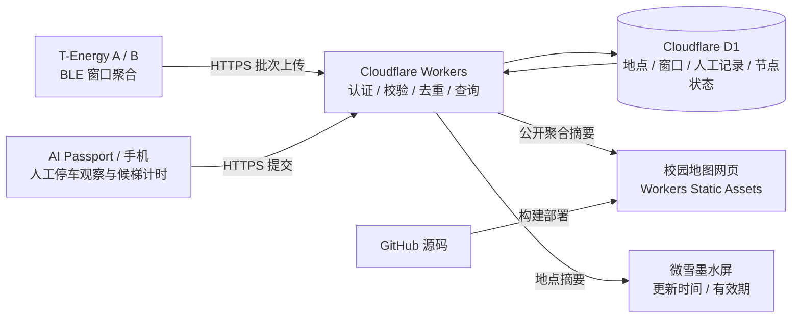
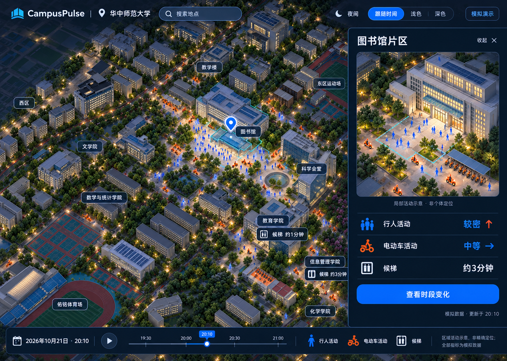

# CampusPulse 黑客松整体方案与 MVP

日期：2026-10-23（Asia/Shanghai）。状态：方案草案；仅完成仓库基线与方案整理，
本轮没有实现新固件、后端或前端，也没有部署、烧录或验证硬件。

用户已确定：重新实现应用，可参考赛前思路和设计图；现有设备为 AI Passport ×2、
T-Energy-S3 ×2、微雪 1.54 英寸墨水屏 ESP32-S3 AIoT 板 ×1；网页、API 和数据库
全部托管 Cloudflare，GitHub 只保存源码。截止时间、必选赛题和团队人数尚未提供。
下文的数量、时延、刷新周期和测试时长均为建议验收目标，尚未测得。

## 1. 产品主线

**一张校园地图，查看地点的活动变化、停车区观察和最近候梯实测；用便携设备补充
现场信息，用墨水屏把这些信息带回现场。**

保留旧方案的三个场景，但明确每项信息的来源：

| 场景 | MVP 数据来源 | 用户看到什么 | 后续扩展 |
| --- | --- | --- | --- |
| 校园活动 | 两个固定节点的 BLE 观测窗口 | 观测活动变化、近 1/5/15 分钟趋势、覆盖与更新时间 | 与人工观察对照后研究活动等级 |
| 电瓶车 / 停车区 | 人工数量范围与拥挤程度记录 | 某停车点最近的人工观察、记录时间 | 经标注验证后研究车辆信号候选 |
| 电梯 / 候梯区 | 人工开始、结束计时与现场备注 | 最近一次候梯耗时、样本数量、记录时间 | 有足够现场证据后研究等待参考 |

BLE 标识数不能直接变成人数、车辆数或候梯时间。两个采样点只说明各自附近的观测，
地图其余区域显示“未覆盖 / 暂无数据”；不插值成全校已测热力。
三类信息共用地点与时间，保留各自单位和来源，不混成一个没有依据的总分。

## 2. 五台硬件的分工

| 设备 | 建议角色 | MVP 工作 | 约束与确认项 |
| --- | --- | --- | --- |
| T-Energy-S3 A | 固定观测节点 A | 放在图书馆入口附近等获准点位，BLE 窗口聚合、Wi-Fi 上传 | 核对板卡版本、电池、联网与射频表现 |
| T-Energy-S3 B | 固定观测节点 B | 放在停车区或第二入口，运行与 A 相同的采集程序 | 与 A 使用相同扫描配置，仍需现场比较差异 |
| AI Passport A | 便携现场记录终端 | 选择地点、记录停车数量范围、候梯开始/结束、查看提交状态 | 优先做三按键小界面；本地保存成功与云端确认分开显示 |
| AI Passport B | 受控测试信标与备用终端 | BLE 广播开/关，验证两个节点能否观测到变化；后续可切换记录终端模式 | 测试广播单独标识、统计，默认从公众活动指标排除 |
| 微雪 1.54 英寸墨水屏板 | 地点状态牌 | 通过 HTTPS 拉取单个地点摘要，显示更新时间与有效截止时间 | 确认黑白/四色 G、触摸与硬件版本后选择驱动 |

厂商资料显示 T-Energy-S3 V1.0 为 ESP32-S3、16 MB Flash、8 MB PSRAM、18650
电池座方案；这是厂商规格，尚未核对手头两块板。AI Passport 的参考硬件为
ESP32-C3、8 MB Flash、无 PSRAM、240×320 屏与三个按键。微雪对应 1.54 英寸
ePaper 家族，不能仅凭尺寸决定具体屏幕驱动。来源见本文末尾。

MVP 核心是“两点采集＋网页＋人工记录”。墨水屏属于完整展示目标，第二台
Passport 主要用于验证；若赛程紧张，允许网页先承担人工记录，再补便携终端。

微雪屏不承担地图动画或逐秒倒计时，建议约 60 秒拉取一次或状态变化时刷新，
最终周期须按具体面板要求调整。断电后墨水屏仍可能保留旧画面，因此每页必须
直接写明“观测于 HH:mm / 有效至 HH:mm”，不能只依赖软件之后刷出“离线”。
电池续航、深睡策略和持续扫描功耗均需实测；先用 USB 供电验收链路。

## 3. 全 Cloudflare 架构

推荐 **React + Vite + TypeScript 前端，Workers API，D1 数据库**。
前端使用 Workers Static Assets，与 API 共域。GitHub 用于源码、评审与构建触发。
不需要额外 VPS、Docker 收集服务或 GitHub Pages 站点。

Cloudflare 官方支持静态资源与 API 共用 Worker，D1 提供面向 Worker 的托管 SQL。
这是平台能力，手头设备到 CF 的现场可达性、账号资源和实际费用尚未验证。
初次部署时核对当时的套餐配额；不预先承诺零成本或校园网络必然可达。

MVP 采用 HTTP 批量上传与网页轮询，不引入 MQTT、WebSocket 或跨节点身份追踪。
暂不增加 R2、KV、Queues 或 Durable Objects；若后续需要较大素材/实验归档，
再按实际体量引入 R2。既有地图示意图可先随静态资源部署。

建议接口边界（待数据契约定稿）：

- `POST /api/v1/windows`：节点聚合窗口，按节点凭据鉴权；落库后 ACK。
- `POST /api/v1/observations`：人工观察与候梯完成记录，需操作员或受限终端身份。
- `GET /api/v1/places`、`GET /api/v1/places/:id/summary`：公开聚合信息。
- `GET /api/v1/places/:id/history`：限制时间范围的历史查询。
- `GET /api/v1/nodes`：运维查看健康状态，需授权。

浏览器与墨水屏不持有设备上传密钥。操作员入口可由 Cloudflare Access 保护，
上线前验证可用身份方式；设备上传使用独立的每节点凭据，不能被交互式登录拦截。
前端公开接口只返回筛选后的聚合字段；写入接口要校验身份、地点、范围与请求大小。

## 4. MVP 必须做的六件事

1. **真实两点数据**：两个 T-Energy 分别登记地点，以相同配置扫描 BLE。
   先按 30 秒形成一个窗口，保存报告数、窗口内可见标识数、有效扫描时长、
   丢失/溢出计数与固件/配置版本。实际配置在单节点真机验证后确定。
2. **可靠到达 CF**：窗口先进入有界持久队列，联网后上传；服务端用
   `(node_id, boot_id, window_seq)` 幂等去重，落库成功后确认。
   断网、队满、重启和补传必须有可见状态，ACK 前不静默覆盖未确认窗口。
3. **一张可用的地图**：缩放、地点选择、两点状态、局部详情、近 1/5/15 分钟
   趋势、来源和更新时间；手机能完成查看。无数据与离线有明确状态。
4. **人工记录闭环**：一个简洁入口选择地点和场景，提交停车数量范围/拥挤状态，
   或开始候梯并在上梯后结束计时；可取消、纠正误录并在网页上看到结果。
   用户界面应写“最近一次实测等待”，不把过去的样本写成当前预测。
5. **墨水屏地点卡**：展示一个地点的摘要、来源、观测时间与有效截止时间。
   字数不足时采用分屏或轮换页；不为了放下所有指标而牺牲可读性。
6. **可复现演示与降级**：现场信标开/关和人工记录能在网页看见结果；独立的
   模拟/回放入口可离线解释交互。模拟不能自动填进“实时”视图掩盖数据中断。

暂缓：精确人数/车辆统计、蓝牙个体轨迹、跨点去重、车辆品牌识别、自动候梯
预测、摄像头、人脸、全校覆盖、导航路线、真实 3D 校园重建和语音助手。
三场景入口可同时存在；没有证据的指标显示“暂无数据”。

若赛题要求 AI，可在上述闭环通过后增加“依据最近观测回答地点问题”的小功能，
回答携带地点、来源和时间；数据不足时明确缺失。模型接入和费用另行验证，
MVP 不把规则摘要宣传成已实现的 AI 推断。

## 5. 数据口径、保留和时效

- 云端默认保存聚合窗口；窗口内去重只在节点临时内存中进行，不上传旁观者
  MAC、原始广播、长期可关联标识或个人轨迹。调试原始采集只针对单独授权的
  受控实验，在本地限时保留，不进入公开仓库或公众接口。
- 可见标识数保留其原始含义；表满时携带饱和标记，不能当作精确数量。
  展示报告速率时依据有效扫描时长；缺失窗口是缺失，不能补零冒充安静。
- 先展示同节点时间变化和人工来源。跨节点比较须记录扫描参数、安装位置与
  设备差异；没有标定前不提供“哪个地方人数更多”的断言。
- 所有记录带 `schema_version`、地点/节点、事件 ID、采集与接收时间、
  `source`（sensor/manual/demo）、时间可信度和质量状态。
  `live/replay` 是查看模式，不能替代来源标记。
- 未校时记录保留启动相对时间和服务器接收时间，并标记时间不确定；重连补传
  不得被当成当前窗口，不能因接收时间新就显示为新鲜数据。
- 建议在线状态超过 120 秒无有效心跳后过期；人工停车与候梯默认 15 分钟后
  显示“历史观察”，而非当前状态。不同场景 TTL 在契约中显式配置。
- 建议公众界面先提供近 24 小时聚合历史，服务器试验数据默认保留 7 天后清理；
  这是拟采用政策，需在真实采集前确定并实现。调试数据按更短实验期限处理。

## 6. 借用之前的设计

复用视觉方向：校园概览＋右侧局部详情、浅色主主题/夜间主题、蓝色活动层、
橙色电瓶车层、候梯信息、底部时间轴与手机底部详情卡。图中的人物、车辆与
等待值为示意，不能直接接成个体定位或真实预测。初版可先做地图锚点与详情，
动画、夜间灯光、建筑透视按剩余时间补充。

设计图是赛前素材，必须披露；本轮只复制了该概念图，未搬旧 React/固件/后端代码。
已检查最终副本的图片元数据，未发现内嵌隐私字段，详见[复用记录](../notes/reuse.md)。
概念校园不能作为真实地理底图；如使用此前学校 GIS 素材，需要确认展示与再分发
权限、保留来源，并沿用其图像坐标边界。未确认前可使用自制示意底图和手动锚点，
不因此阻塞真实节点演示，也不声称导航或米级定位。

## 7. 验收目标和演示顺序

以下是建议目标，未完成实测：

| 验收 | 建议通过条件 | 证据 |
| --- | --- | --- |
| 现场可达 | 两节点、手机和墨水屏在同一演示网络可连接 CF HTTPS | 按设备记录请求成功与失败 |
| 双节点采集 | 连续运行至少 30 分钟；缺口、队满、重启均可解释 | 节点计数与云端窗口对账 |
| 页面时效 | 联网正常时，已结束窗口在 60 秒内出现在页面 | 采集结束、落库与页面显示时间 |
| 离线恢复 | 主动断网 5 分钟后补传；重复重试不增加重复窗口 | 期望窗口、ACK、缺口与数据库计数 |
| 人工记录 | 真实停车观察、候梯计时分别至少一例，可取消/纠正 | 终端、接口与网页结果一致 |
| 墨水屏 | 摘要与网页同来源；断网/断电后保留有效截止时间 | 实机照片与对应摘要版本 |
| 手机流程 | 查看地点→切换时段→录入/纠正→查看结果完整可用 | 真浏览器与手机现场检查分别记录 |
| 来源边界 | 实测、人工、受控实验、模拟可辨；断网不混入模拟值 | 页面、数据库与演示讲稿检查 |

建议演示：打开两点地图 → 开/关受控信标并查看独立测试通道 → 查看真实观测
窗口 → 现场提交停车观察和一次候梯计时 → 网页及墨水屏更新 → 展示一次断网
恢复或有明确标签的历史回放。信标试验只证明受控链路，不证明真实人流准确率。

## 8. 实现顺序与裁剪

| 顺序 | 交付 | 进入下一阶段的条件 |
| --- | --- | --- |
| A | 硬件清点、CF 可达、最小数据契约、网络与分区确认 | 一台 T-Energy 可发送测试窗口；明确受控/模拟来源 |
| B | Worker + D1 + 一台真实采集节点 + 简单网页 | 真实窗口落库并显示，重复请求幂等 |
| C | 第二节点 + 地图详情 + 人工记录手机入口 | 两点、三个场景的信息来源都清楚 |
| D | Passport 现场记录 + 墨水屏摘要 + 恢复测试 | 硬件与网页完整闭环 |
| E | 设计打磨、回放、打印外壳、讲稿与证据归档 | 演示冻结后仅修阻塞问题 |

若赛程不足，先裁掉地图动画、夜间效果、AI、第二台 Passport 的额外应用及定制
外壳；再将 Passport 录入降级为手机录入。保留真实数据到 CF 到网页的完整链路。
具体工期待截止时间与团队人数明确后排定，不按未知赛程承诺完成时间。

## 9. T-Energy-S3 外壳

已找到作者明确使用 T-Energy-S3 的 InkCast 外壳发布入口，但其整机包含 3.97
英寸墨水屏，不是裸板小盒。官方仓库当前提供 DXF 结构文件，没有找到官方
STL/STEP 外壳。适合先研究安装结构，再为本项目的两台纯采集节点做简洁小盒。
详见[外壳资料](../research/t-energy-s3-enclosure.md)。

## 10. 核验来源

以下网页在 2026-10-23 查询，属于厂商/平台资料，不能代替手头设备的真机验收：

- [FoloToy AI Passport](https://github.com/FoloToy/ai-passport)：板卡能力与资源约束。
- [LILYGO T-Energy-S3](https://github.com/Xinyuan-LilyGO/T-Energy-S3)：V1.0 规格与结构资料。
- [微雪 ESP32-S3-ePaper-1.54](https://docs.waveshare.com/ESP32-S3-ePaper-1.54)：黑白版家族。
- [微雪 ESP32-S3-ePaper-1.54G](https://docs.waveshare.com/ESP32-S3-ePaper-1.54G)：四色 G 版。
- [Workers Static Assets](https://developers.cloudflare.com/workers/static-assets/)：静态前端托管。
- [Workers 全栈路由](https://developers.cloudflare.com/workers/static-assets/routing/full-stack-application/)：前端与 API 共域。
- [Cloudflare D1](https://developers.cloudflare.com/d1/)：托管 SQL。
