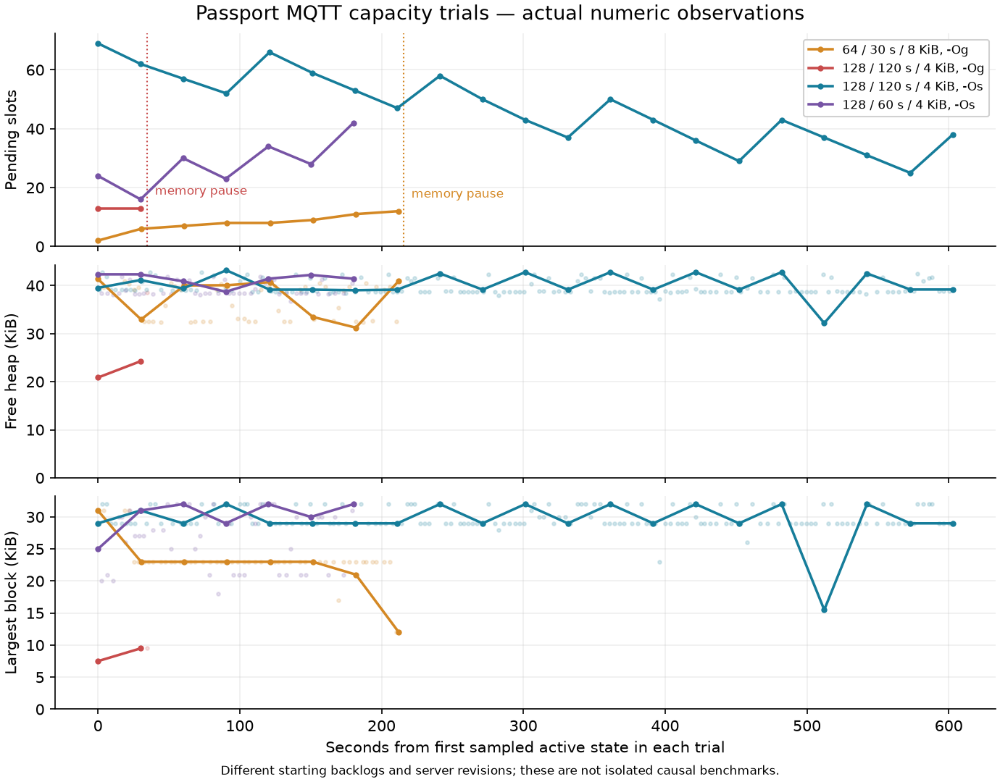

# MQTT capacity and Wi-Fi reconfiguration recovery

Date:2026-10-29, Asia/Shanghai. This follow-up supersedes the retained16-address
policy as a development target, not the historical measurements in
[address capacity](address-capacity-and-public-path.md). Firmware source,
host simulations, production server checks and physical acceptance are separate.

> Current user decision: pause capacity escalation and observe64 addresses at
> 120s windows/40s bins/4096B bodies on the same size-optimized image. The device
> ACKs the fresh field policy. Keep every old batch and all failed trials; the
> earlier ten-minute128 result is not a long-run acceptance claim.

## Current64 observation and longer-run boundary

A later same-boot128/120s snapshot contains30 complete windows (mean117.57
addresses, maximum128),4 table-overflow windows,8 upload failures and113 pending
slots. Window/summary/storage/ACK-loss counters remain0, but this fails long-run
queue acceptance. A subsequent128/180s attempt also hits memory protection and
is not accepted. No stable128 operating claim is made from the short trial.

The user then selects64 for observation rather than further pressure tests.
The selected field policy is64/120s/40s/4096B, with scan settings unchanged. No
firmware reflash occurs: the compiled128 ceiling and16384B static core banks
remain; only selected-bin allocation falls3072→1536B. This is a runtime64 policy
comparison, not an image with only64 compiled core slots.

A local read-only monitor samples current control, latest same-boot status and
bounded15-minute receipt counts through Wrangler every15minutes. It keeps
private aggregate history, separates new-boot baselines and software-loss/ACK
increments from expected address-table overflow, and leaves serial ports and
all device/account configuration unchanged. Cloud largest-block/minimum-heap
telemetry is unavailable and remains unknown; free heap and reported pause
reasons are observed instead.

The initial64 sample confirms the selected policy and matching status. It still
has151 pending slots,23 cumulative upload failures and a reported memory-pressure
pause; those are baseline values, not zeroed or relabeled as new64 losses. Free
heap is97984B, storage free2334720B, and window/summary/storage/ACK losses are0.
The sample is several minutes old, so it is not a live assertion of the current
scanner state. This observation phase has not yet established long-run stability.

## Production Wi-Fi reconfiguration failure

Chrome reads the correct USB factory identity, then fails at the existing-node
lookup, before MQTT credential recovery or Wi-Fi candidate submission.
The actual request is `GET /api/v1/admin/devices/:id`; it returns503 with
`storage_unavailable`. The deployed safe diagnostic identifies
`storage_timeout`, without logging raw exceptions, bodies, headers or secrets.

The former device query joins two whole-history UNION views. Its production
query plan materializes `all_ingestion_batches` and `all_node_status`, scans the
batch join and repeats correlated latest-history sorting. The old full query
exceeds a25s read deadline; a bare production `SELECT 1` takes0.2204ms of SQL.
The error is not evidence of invalid MQTT passwords or broker ACLs.

`14d2634` replaces that query with one indexed latest-row probe in each v1/v2
base table and selects the latest result with deterministic timestamp/ID/sequence
ordering. Migration0008 adds three latest-history indexes, retaining every
observation, old index, policy and credential. Latest status is exactly one row
even when a frozen status batch contains multiple records.

| Check | Evidence |
| --- | --- |
| Local6000-batch comparison | 5293.83ms old / 0.24ms new; synthetic, not production timing |
| Production optimized device query | 0.871ms SQL,9 rows read,1 registry node returned |
| Production placements query | 47859→3512 rows read;38.757→29.743ms SQL |
| Chrome existing-node flow | Same aipp1 restores its registered identity, original place/purposes and saved MQTT; Wi-Fi submit is enabled |

The indexed query, v1/v2 ordering/ties, multi-status batches and placement counts
have dedicated regressions and a real local workerd/D1 enrollment smoke.
The safety diagnostic adds only a validated random error reference to the
original503 response/UI, plus a canonical operation and fixed category in logs.
It does not loosen authentication, rotate credentials or change API success data.

## Bounded summary packing

The collector already supports64 addresses;16 was the selected remote policy.
The previous codec also forced at most6 summaries per frozen batch, independently
of the allowed8192 body bytes/16 items. Increasing address count alone could
therefore overload the synchronous RPC service.

`d92e010` serializes one address at a time using the existing cJSON value/field
semantics, appending complete item bytes into a bounded immutable body. It seals
at the actual byte/item budget, instead of retaining a whole multi-address JSON
tree. Previously frozen journal bodies are neither regrouped nor rewritten.
Unknown clock values, counters, quality evidence and item order remain intact.

| Synthetic64-address/30s/5s/raw-off fixture | Previous | Packed |
| --- | ---: | ---: |
| RPCs per window, including window/status | 13 | 7 |
| JSON bytes per window | 41817 | 39609 |
| Maximum body bytes | 3692 | 8124 |
| Requested host JSON allocation peak | 19100B | 11631B |

These are actual production-codec outputs for one reproducible synthetic case,
not worst-case sizes or ESP32 heap measurements. Larger packed bodies increase
the unchanged MQTT pre-body admission requirement from30170B to39034B in this
case, because the immutable caller body and QoS1 outbox are separate copies.
Contiguous-block admission remains17058B. No memory guard is weakened.

The source accepts1–300s summary windows in integer milliseconds with dividing bins, at most16
bins and64 addresses, within the existing server contract. The test matrix uses
10/30/60s windows and5s bins. Static address cores remain8192B; selected active/
sealed storage is `8192 + 2*N*B*4 + 780` bytes before allocator metadata/alignment.
128 addresses remain unsupported; radio completeness is never inferred from a
finite table or a passing build.

ASAN/UBSAN covers3854 multi-batch allocation-failure points,7 sink failures,
exact body boundaries, sequence exhaustion, full pipeline memory failures and
111 real-codec batches accepted by the server validator. The reproducible
[offline experiment](../../experiments/mqtt-capacity/README.md) compares144
workloads/504 stream groups/5952 exact item strings plus parsed semantics.
Batch grouping changes1320→840; the item data does not change.

## Physical acceptance

Selected build: `mqtt-14d26343df5c`, source
`14d26343df5c8c0ef5a23673c488ba4af85fbcc7`, ESP-IDF5.5.3, ESP32-C3/8MiB/no PSRAM.
App1575152B, SHA256
`491d098c544950aab09a62be0611820be4329dbe2e4ccf6f681b121b238b9b32`.
The user saves a new network through the repaired Chrome flow. The app write and
its hash verification succeed, but USB disconnects during the subsequent full
comparison. After reconnection, the same physical board's app readback matches
the selected image. A verified full8MiB read confirms all bytes outside NVS and
the journal, including bootloader/partition/cardid, match the expected overlay;
NVS/journal differ after the intervening boot. This is not a completed preboot
full-equality check. No repeat app write or erase is used for that recovery.

The planned sequence is a fresh full8MiB backup, app-only write and full expected
Flash comparison, preserving the newly saved Wi-Fi/MQTT settings, cardid and old
journal. Then activate a new immutable64/30s/5s/raw-off policy through the admin
flow, check the actual applied ACK, measure steady queue/heap/receipt behavior,
and separately exercise shorter/longer windows. Keep old policies and frozen
batches. Stop pressure tests before storage exhaustion and retain explicit
timeout, loss, address-overflow and recovery counters.

The official admin flow publishes an immutable64/30s/5s/raw-off test policy,
retaining the original16-address field version. D1 confirms the new image,
matching boot and applied policy in `controlled_test`. The scan remains
100ms interval/20ms window with duplicate filtering off.

### Failed64-address/8KiB baseline

The planned ten-minute continuous run does **not** pass. At278.401s of device
time the heap guard pauses collection: internal free41972B but largest block
12288B. Before that event, sampled active states span212.195s and reports rise
384→7612 (7228 received reports, about34.06/s); queue2→12. There are3 observed
allocation failures requesting1630B with capability mask2060, plus upload
admission denials. Maximum observed RPC body is8180B. No observed callback,
window, summary, raw, storage or seal-overflow loss occurs in that bounded run;
that is not a radio-completeness or memory acceptance result.

A later same-boot D1 snapshot, outside the serial cohort, has17 full30s windows:
all contain64 admitted identifiers and all mark address-table overflow. It shows
18586 reports across those full windows,678 overflow reports in the latest
status,8 upload failures and zero unpersisted-window/window/summary/storage/ACK
loss. Background pause/recovery and partial windows are retained separately.

The old image is then assigned a new64/120s/40s policy with4096B bodies. This
stops generating new8KiB bodies while preserving the original frozen requests.
A new pre-128 full backup is CRC-inspected:14 pending bodies, none over4096B,
maximum3831B,327 ACKed slots, no quarantined headers. The initial short recovery
capture contains buffered older USB logs and is not an acceptance cohort; the
subsequent observer fences logs by a freshly read device uptime.

### Explicit128-address trial

The user explicitly requests128. `5640243` raises the collector/parser, board
ceiling, server validation, OpenAPI and configuration editor together to128;
The selected C3 build rejects129/256; larger S3/PSRAM capacities are separate
board work.32-bit counters and all memory guards are retained.
The first candidate is128/120s/40s/raw-off/4096B:16KiB static cores,3072B dynamic
three-bin counters and780B fixed structures,20236B before allocator metadata.
It adds8192B to64×6, rather than11264B for128×6. The128×3/4096 host JSON peak is
7352B, and a synthetic full window persists21 batches including window/status;
those are host outcomes, not device acceptance.

The frozen128 image is `mqtt-777f82e2dfe4`, from commit
`777f82e2dfe41ca93c9418da29a9406b70a06ace`, app1575152B, SHA256
`b327ab8419a0c73359b3e12ff7a64f60968839337b00c54e03ba914a829a2caa`.
Its ELF confirms the two core banks occupy16384B. Other sessions' uncommitted
Heap UI/help and new-board work are excluded from the frozen source. A fresh
full8MiB backup and the no-large-pending-body gate precede the app-only write.
The official128 policy is actually applied, but the first debug-optimization
run fails: a3831B preserved old-boot request times out after35525ms including
SDK waits/cleanup; by67.293s the memory guard pauses at43024B free/largest13312B.
At32.405s, an in-flight sample is21364B free/largest7680B. No failed allocation
is captured in that short cohort. A later D1 snapshot has no complete120s
window, only partial windows, and pending reaches79. Thus it establishes neither
sustained128 collection nor128-address upload throughput. Capture, protection
and retained records remain explicit; the device is paused before further work.

A separate same-source size-optimization candidate changes compiler mode from
`-Og` to `-Os`. App1575152→1423168B, IRAM text90226→80648B, static DRAM data+BSS
82196→81932B. Both ELF files retain the same16384B core-bank symbol; this is
linker evidence, not measured free heap. The SDK disables its debug-only
FreeRTOS task-function wrapper in size mode; TLS buffers, full CA validation,
radio pools and memory guards are unchanged. The public supplemental profile is
[`size-opt.defaults`](../../firmware/diagnostics/memory-profiles/size-opt.defaults).
Image `mqtt-os-777f82e2dfe4`, SHA256
`917bf1387939d874f8d470abdf38d4ee08f4cd7a069ecaaf18d7e5cf6e690fff`,
uses the same frozen777f82e source and that profile. A fresh backup retains74
pending batches (all≤4096B). The full Flash comparison before this boot passes,
including NVS, cardid and every old journal byte outside the app overlay.

### Bounded128 acceptance and refresh pressure

The size-optimized candidate passes667s of serial observation and602.821s
of sampled continuous active collection (602821ms). One boot is
verified. Active-state reports827→19957 give19130 received reports over that
span, about31.73/s; these are received advertisements, not known transmissions
or a physical-device census. All172 RPCs include one cold connection and171
actual reuses;171 return200 and one is the preserved historical422. Validated
upload receipts cover131 batches/437338 body bytes, including old backlog;
59 batches/192135 body bytes belong to the new boot. Do not divide those mixed
totals by only the active-state span or call them a saturated service rate.

The boot starts with74 pending slots; first/last active samples are69→38.
After a60s active warmup, pending57→38 over542.766s (endpoint−2.10 slots/min;
least-squares trend−3.35 slots/min). The regular increases at a window boundary
are whole-window production, not lost records. Heap is typically around39–43KiB
with29–32KiB largest blocks; sampled minima including RPCs are32960B free and
15872B largest. Those transient minima do not trigger the unchanged sustained
idle-pressure guard. Failed-allocation monitor delta, memory/pressure pauses,
callback/input/window/summary/raw/storage/seal-overflow losses and upload/ACK
failures remain0. Seal wait peaks5082ms and persistence1195ms.

An independent post-run D1 snapshot confirms the same image/boot, applied
128/120s/40s/4096B policy and5 full windows containing96–108 distinct
address/type pairs, mean101.6, no table overflow. It has64 summary batches/379
items plus5 window and5 status batches at that snapshot; some remaining address
details are still behind retained FIFO backlog. Thus configured128 storage and
actual more-than64 observations are verified; this cohort does not prove an
always-full128-radio-device or high-advertisement-rate ceiling.

A separate same-boot60s/20s/4096B pressure case passes180.241s without new memory,
allocation or software-loss counters, but pending24→42 over the sampled span:
about+5.99 slots/min endpoint/+5.85 fitted trend. It fails sustained queue
balance. A later snapshot has5 full windows with93–109 addresses, no table
overflow, but56 pending address batches plus1 window. The original scan duty
and received-report handling are unchanged; shorter uploads cannot be advertised
as a free refresh improvement.

The official admin flow then publishes a fresh128/120s/40s/4096B version and
restores the original `field` dataset/place/purposes. Controlled test versions
remain immutable. The restored version is explicitly ACKed on the same boot;
a separate three-minute recovery observation retains zero failures/loss/allocation
increments. Its1.5-window endpoint includes a production burst, so it is not
used alone for a steady-state claim. A following field snapshot contains10
full120s windows,99–128 addresses (mean113.8), no table overflow, zero reported
software/upload/ACK losses, and44 pending slots. That later snapshot is outside
the serial cohort. Physical placement labels are retained, not re-verified by
this bench test. The device remains collecting on the user's new network.

A later read-only join at2026-10-29T14:55:03+08:00 confirms3 windows with128 admitted
addresses and all128 matching address-summary items persisted. One has no table
overflow; two later crowded windows do. A still-newer128-address window is only
partly uploaded at the instant of that query, so it is not counted as complete.
This later evidence does not extend the earlier serial-cohort claims: exceeding
128 still omits per-address detail and records table overflow, while overall
report counts remain available. The current C3 experiment does not remove a
finite address bound or establish a256-address physical result.

The measured size mode is now the Passport fresh-build default. Existing build
directories must select size mode or use a fresh SDKCONFIG; defaults alone do
not override an already generated config. Fresh onboarding uses a conservative
64/120s/40s/4096B template; existing configurations are reused and the tested
Passport retains its explicitly selected128 policy. This avoids reintroducing
the known8KiB/30s resource pressure for newly provisioned nodes.

The [main pipeline samples](../research/metrics/mqtt-capacity-trials-20261029.csv)
contain only relative times, counts and memory sizes. Starting backlogs and
server revisions differ; this figure is an observation comparison, not an
isolated causal benchmark. The final PNG is stripped and checked with ExifTool:
only structural image tags remain, with no EXIF/GPS/XMP/IPTC/comment metadata.

The failed debug trials used the earlier server path; the successful size case
uses the separately verified incremental-public-cache backend (functional
revision930369c4, later same-code CI deploymentd23bfe36). Controlled-test rows
are not projected into the public cache. Compiler/linker gains are measured
independently; differences in RPC time are not attributed solely to `-Os`.

## Capacity interpretation and current service limits

Nearby BLE addresses, received reports/s, sensor nodes connected to the broker,
window length and frontend polling are different quantities. Five-second bins
are window resolution, not five-second uploads. The offline1/2/5/10Hz cases
inject already-received reports; without controlled beacons and known transmit
counts they establish no radio reception ceiling.

The historical successful RPC median1958.5ms plus the existing nominal1000ms
yield predicts utilization0.690 for this packed64/30s fixture, before controls,
retries or persistence. At64/10s it predicts2.071, so queue growth is expected.
These are planning scenarios, not measured current service rates. Use actual
new-path mean service time and queue slopes to accept a final policy.

EMQX Serverless documents1000 concurrent connections,100 new connections/s,
1000 aggregate publish/subscribe TPS and2000 authorization rows. These are
separate ceilings, not an accepted fleet size. The CF reply publisher currently
opens one connection per RPC; per-device ACLs and the CF/D1 service can bind
earlier. See [official limits](https://docs.emqx.com/zh/cloud/latest/create/restriction.html).

The deployment's CNY0 cap remains unchanged. With a hypothetical full unused
1GiB allowance, this synthetic64/30s workload has at most95.43 node-hours from
its traffic lower bound, before replies, framing/TLS/HTTP, controls, retries or
previous usage. This is not the current remaining allowance or a guarantee of
free continuous operation. [EMQX pricing](https://docs.emqx.com/zh/cloud/latest/price/pricing.html)
and [Cloudflare D1 pricing](https://developers.cloudflare.com/d1/platform/pricing/)
must be considered separately; D1 row writes include index updates. No plan or
spending limit is changed by these calculations.
