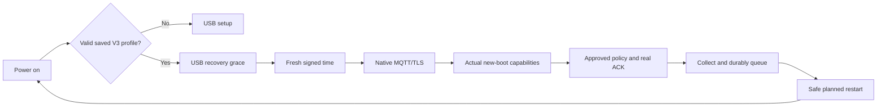

# Persistent V3 startup

Status: implemented and locally verified; CI/CD publication and actual-device
restart acceptance are separate. Production telemetry continues to use
[native MQTT](device-v3-mqtt.md), not a computer relay or HTTPS data fallback.

## Operator workflow

The default USB test remains temporary and bounded. The operator may explicitly
select **save and automatically start**, supply production settings and obtain
the clock public key over trusted host HTTPS. `V3 START ACCEPTED` means only that
the frame was accepted. Saving occurs after the real production policy is
applied, its committed ACK matches, and storage budget admits the write.
Only `V3 STARTUP SAVED` confirms the selected NVS record's commit/readback.
Failure or timeout cannot be shown as saved.

The administrator separately approves a renewable startup grant from the
actual current applied statistics policy. The UI offers explicit1/7/30day
approval; absence means off. Source generation, policy limits, placement and
revision are validated by the backend. This does not fabricate an ACK or permit
the device to increase its own limits. First approve/save, then test restart.



The saved-profile path needs no USB settings or host clock. Transient network
and time failures retry with bounded backoff, without beginning capture.
Physical/manual stop takes priority. Approximately20minute cycles safely drain,
freeze, sync/unmount and stop transport before a real software restart, retaining
the existing30minute capability and clock bounds. A new boot UUID is generated;
old bodies retain their original identity, bytes and expiry. Uncertain writes
or volatile handoffs block restart. Gaps and reboot boundaries remain explicit.

Waveshare V2 GPIO17 hold is retained over safe software restart, then released
only after high-output configuration on the next boot. T-Energy does not inherit
this pin. Battery-only behavior requires actual-board validation.

Long BOOT enters safe USB configuration. A browser-requested safe `RESTART`
sets a one-shot RTC marker so the next boot waits for USB rather than auto-start.
Ordinary power-on uses the saved profile. The original four-page UI is preserved;
USB messages distinguish saved configuration from first setup.

## Persistent configuration

The dedicated ordinary-NVS namespace `cpv3start` stores validated native
production settings, explicit auto-start choice and pinned P256 SPKI/key ID.
It never implicitly loads/migrates legacy settings or queues. UTC seeds,
boot/batch identity, test-window limits and isolated CA/origins are not saved.
Only personal/open profiles can auto-start; the initial USB UI supports personal
Wi-Fi. PEAP needs trusted time before RADIUS authentication and is refused on
this cold-start path rather than weakening its certificate checks.

Variable-length records have version/CRC/node binding and real P256 point
validation. An inactive blob commits/read backs before selector commit/readback.
An orphan is never promoted. An uncertain selector operation can leave old or
complete validated new active; the current boot stops without claiming success.
Explicit trusted-USB recovery repairs only this namespace's affected keys.
Normal save/recovery preauthorize8192/16384 logical metadata bytes. Ordinary NVS
is not encryption at rest, anti-rollback hardware or a physical wear guarantee.
RAM secret copies are wiped; secret values never enter source or logs.

## Authenticated time

The clock module temporarily owns Wi-Fi. SNTP is only an untrusted candidate
date for a credential-free HTTPS probe; CA, hostname and date checks remain on.
No device token, MQTT credentials, node identity or cookies enter that request.
Only independent signature/fresh-nonce verification using the physically pinned
key establishes time. The temporary network is cleaned up before formal
MQTT/TLS starts. Failed probes clear the anchor and restore the old clock mapping.

`POST /api/v3/clock` accepts exactly `{nonce}`:64lowercase hex characters from
32fresh random bytes. Its exact response fields are schema, audience, key_id,
nonce, unix_ms, max_error_ms and sig. Schema is `cp-v3-signed-clock/1`, audience
is the fixed production origin, key ID is1..32ASCII alphanumeric/underscore/hyphen,
timestamps/errors are decimal integers, and sig is unpadded base64url raw64byte
P256 r||s. SHA256/ECDSA signs these ASCII lines with a final LF:

```text
cp-v3-signed-clock/1
{audience}
{key_id}
{nonce}
{unix_ms}
{max_error_ms}
```

Freshness spans headers-sent immediately before nonce body transmission through
complete response; DNS/TLS latency precedes it. Client bounds are6000ms RTT and
4000ms resulting uncertainty, including signed server error, half RTT,500ppm
timer error and1ms quantization. Unknown/duplicate fields, nested JSON, escapes,
wrong key/nonce/audience or signature fail closed. The configured1000ms server
bound is an operator assumption, not a physical clock measurement.

`GET /api/v3/clock/key` returns only schema/audience/key_id/public_key_spki.
It is trusted only during explicit first USB setup; boot never TOFU-replaces
its pin from a response. Private key material is a Worker Secret. Rotation needs
deliberate reprovisioning. Clock endpoints reject auth headers, cookies and query.
See [clock component](../../firmware/components/cp_v3_clock/README.md) for details.

## Renewable authorization and limits

`GET/POST /api/v1/admin/device-v3/nodes/:node/startup-grant` uses authenticated
admin revision checks. Enable requires actual applied source generation, explicit
expiry (max30days), policy TTL (max30minutes) and acceptance grace no broader
than the source. Manual assignment revokes automatic lineage. Lazy GET mint,
manual assignment/revoke, ACK and lease retain transactional version checks.
No new lease exists before a real device ACK. Historical envelopes, source TTLs,
acceptance deadlines and receipts are not rewritten. Revocation cuts future
authority rather than deleting previously authorized history.

Grant renewal is still an administrator task. Existing4096entry history ceilings
remain (about57days of20minute cycles, less existing history). Persistent daily
quotas survive restart. T-Energy retains its1MiB storage/128KiB uplink ceilings
and conservative NVS headroom; autonomous startup is not all-day/endurance proof.
Long offline, full queues, arbitrary power loss and field calibration remain
separate acceptance. Builds and host tests are not battery restart evidence.

Migration0019 precedes the Worker. Release needs STARTUP_ENABLED plus clock
key ID/audience/error vars and the private Worker Secret. Per-node grants still
default off. CI/CD publishes code/assets and migrations using the retained
Worker Secret; the private key is not committed or printed in job logs.
