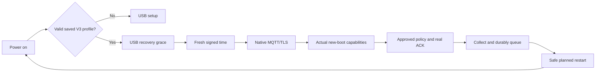

# Persistent V3 startup

Status: implemented and locally verified; CI/CD publication and actual-device
restart acceptance are separate. Production telemetry continues to use
[native MQTT](device-v3-mqtt.md), not a computer relay or HTTPS data fallback.

## Operator workflow

USB setup now defaults to **save and automatically start**, with continuous
operation selected. This covers open/personal Wi-Fi and explicitly unverified
PEAP; cancelling saving retains temporary one-to-three-window runs. Network mode
changes preserve the operator's preference. Strict CA-verified PEAP remains a
manual USB flow because its date checks need independent pre-network trusted
time; automatic startup never silently disables them.

The new submitted setup flow obtains the clock public key over trusted host
HTTPS and waits for fresh node/USB-boot capabilities. It automatically prepares,
validates and assigns a compatible policy using a previously applied template
and valid deployment. Without an approved template, only a sole valid unlocated
deployment may receive the conservative controlled-test profile. Missing or
ambiguous deployment and concurrent administrator changes stop automatic writes.
Ordinary page opening never starts this flow. `V3 START ACCEPTED` means only that
the frame was accepted. Saving occurs after the real production policy is
applied, its committed ACK matches, and storage budget admits the write.
Only `V3 STARTUP SAVED` confirms the selected NVS record's commit/readback.
Failure or timeout cannot be shown as saved.

After SAVED and the matching current durable applied ACK, this submitted flow
requests one seven-day renewal grant. It pins the pre-submit desired generation,
digest and grant revision, validates its own assignment transition and uses
atomic revision checks. Closing, external policy edits, revocation or conflicts
stop the flow without automatic resubmission. Saving and grant success remain
separate states; authentication cancellation cannot be reported as success.
The ordinary configuration page retains explicit 1/7/30-day approval/revocation.
Source generation, limits, placement and revision are revalidated by the backend.
No ACK is fabricated and devices cannot expand their own limits.



The saved-profile path needs no USB settings or host clock. Transient network
and time failures retry with bounded backoff, without beginning capture.
Physical/manual stop takes priority. Approximately20minute cycles safely drain,
freeze, sync/unmount and stop transport before a real software restart, retaining
the existing30minute capability and clock bounds. A new boot UUID is generated;
old bodies retain their original identity, bytes and expiry. Uncertain writes
or volatile handoffs block restart. Gaps and reboot boundaries remain explicit.

Waveshare V2 GPIO17 hold is retained over safe software restart, then released
only after high-output configuration on the next boot. T-Energy does not inherit
this pin. Battery-only behavior requires actual-board validation.

Long BOOT enters safe USB configuration. A browser-requested safe `RESTART`
sets a one-shot RTC marker so the next boot waits for USB rather than auto-start.
Ordinary power-on uses the saved profile. The original four-page UI is preserved;
USB messages distinguish saved configuration from first setup.

## Persistent configuration

The dedicated ordinary-NVS namespace `cpv3start` stores validated native
production settings, explicit auto-start choice and pinned P256 SPKI/key ID.
Autonomous startup never implicitly loads/migrates legacy settings or queues.
UTC seeds, boot/batch identity, test-window limits and isolated CA/origins are not
saved.
Open, personal and explicitly unverified PEAP profiles can be provisioned, saved
and automatically started. `eap_server_verification:"none"` is the
default UI choice when no CA is supplied; it leaves the authentication server
unverified and visibly warns that a fake server may obtain enterprise account
credentials. `"ca"` requires one real CA, an expected RADIUS DNS hostname and
certificate-date checks, with fresh trusted physical-USB time before Wi-Fi.
Invalid supplied trust never silently falls back to `none`. CA-verified PEAP
remains manual USB only, with full certificate-date checking. The signed-clock
probe itself needs network access, so it cannot provide independent time before
the first CA-verified RADIUS association. See the
[USB Wi-Fi authentication contract and evidence](../notes/v3-usb-wifi-auth-2026-11-03.md).

All three modes currently share a printable-ASCII USB/CLI/firmware text contract,
including SSID; this does not establish support for arbitrary UTF-8 SSIDs.
EAP trust material is temporary and never replaces the fixed production MQTT
broker's public CA bundle or the diagnostic HTTPS `server_ca_pem` field. The NVS
profile format v2 adds an explicit PEAP NONE selection without increasing the
1280-byte limit or changing legacy settings. v1 open/personal profiles remain
readable. Disabled v1 PEAP profiles retain unknown trust for read-only credential
reuse; they cannot be promoted to auto-start or re-saved without a new explicit
selection. New profiles reject unknown/CA PEAP trust. No CA material or time seed
is persisted.

Variable-length records have version/CRC/node binding and real P256 point
validation. An inactive blob commits/read backs before selector commit/readback.
An orphan is never promoted. An uncertain selector operation can leave old or
complete validated new active; the current boot stops without claiming success.
Explicit trusted-USB recovery repairs only this namespace's affected keys.
Normal save/recovery preauthorize8192/16384 logical metadata bytes. Ordinary NVS
is not encryption at rest, anti-rollback hardware or a physical wear guarantee.
Owned RAM secret copies are wiped after confirmed teardown; secret values never
enter source or logs. If network stop is unconfirmed, borrowed EAP CA storage
must remain alive until confirmed stop. This is not a claim that the SDK's entire
heap is zeroed.

## Same-node credential reuse during USB setup

`V3 HELLO` exposes only independent `credential_state` and `mqtt_state` readiness
(`ready`, `missing`, `unavailable`), never a token, token hash or password.
Absent fields in older firmware mean unknown. Already registered same-node
devices default to local reuse when ready; START explicitly carries
`reuse_saved_credential:true` without `device_token` and/or
`reuse_saved_mqtt:true` without all four MQTT fields. Fresh node/boot/readiness
checks are required before admission. This is restricted to canonical
`CP_API_ORIGIN` with native production MQTT; it cannot send saved secrets to an
isolated HTTPS endpoint. Readiness does not establish successful network/cloud
authentication or a saved configuration.

The read-only credential helper prefers the valid selected V3 profile and only
falls back to legacy settings on genuine V3-store absence. Corruption, invalid
selector, missing selected blob, wrong node or I/O yields `unavailable`, never
inactive-slot promotion or implicit repair. The receiver reuses only bearer/MQTT
fields; the newly supplied SSID and other network settings remain authoritative.
No legacy writes, profile-format changes or migration occur.

A ready bearer and missing MQTT can independently reuse the bearer and recover
MQTT through the protected administrator endpoint. The server retains only a
device-bearer hash, so cannot recover the original bearer; encrypted MQTT
material can be recovered separately. Missing/unavailable/unknown states retain
manual backup/recovery controls without automatic rotation. Fresh registration
uses its newly returned secrets rather than an old stored slot.

## Authenticated time

The clock module temporarily owns Wi-Fi. SNTP is only an untrusted candidate
date for a credential-free HTTPS probe; CA, hostname and date checks remain on.
No device token, MQTT credentials, node identity or cookies enter that request.
Only independent signature/fresh-nonce verification using the physically pinned
key establishes time. The temporary network is cleaned up before formal
MQTT/TLS starts. Failed probes clear the anchor and restore the old clock mapping.
An explicit PEAP-NONE bootstrap entry configures PEAP identity/username/password
and unverified-server mode, then performs the same strict HTTPS/signed-time
probe. The original clock entry still rejects PEAP. Cleanup clears EAP state and
retains network ownership on an unconfirmed stop; CA-mode behavior is unchanged.

`POST /api/v3/clock` accepts exactly `{nonce}`:64lowercase hex characters from
32fresh random bytes. Its exact response fields are schema, audience, key_id,
nonce, unix_ms, max_error_ms and sig. Schema is `cp-v3-signed-clock/1`, audience
is the fixed production origin, key ID is1..32ASCII alphanumeric/underscore/hyphen,
timestamps/errors are decimal integers, and sig is unpadded base64url raw64byte
P256 r||s. SHA256/ECDSA signs these ASCII lines with a final LF:

```text
cp-v3-signed-clock/1
{audience}
{key_id}
{nonce}
{unix_ms}
{max_error_ms}
```

Freshness spans headers-sent immediately before nonce body transmission through
complete response; DNS/TLS latency precedes it. Client bounds are6000ms RTT and
4000ms resulting uncertainty, including signed server error, half RTT,500ppm
timer error and1ms quantization. Unknown/duplicate fields, nested JSON, escapes,
wrong key/nonce/audience or signature fail closed. The configured1000ms server
bound is an operator assumption, not a physical clock measurement.

`GET /api/v3/clock/key` returns only schema/audience/key_id/public_key_spki.
It is trusted only during explicit first USB setup; boot never TOFU-replaces
its pin from a response. Private key material is a Worker Secret. Rotation needs
deliberate reprovisioning. Clock endpoints reject auth headers, cookies and query.
See [clock component](../../firmware/components/cp_v3_clock/README.md) for details.

## Renewable authorization and limits

`GET/POST /api/v1/admin/device-v3/nodes/:node/startup-grant` uses authenticated
admin revision checks. Enable requires actual applied source generation, explicit
expiry (max30days), policy TTL (max30minutes) and acceptance grace no broader
than the source. Manual assignment revokes automatic lineage. Lazy GET mint,
manual assignment/revoke, ACK and lease retain transactional version checks.
No new lease exists before a real device ACK. Historical envelopes, source TTLs,
acceptance deadlines and receipts are not rewritten. Revocation cuts future
authority rather than deleting previously authorized history.

Grant renewal is still an administrator task. Existing4096entry history ceilings
remain (about57days of20minute cycles, less existing history). Persistent daily
quotas survive restart. T-Energy retains its1MiB storage/128KiB uplink ceilings
and conservative NVS headroom; autonomous startup is not all-day/endurance proof.
Long offline, full queues, arbitrary power loss and field calibration remain
separate acceptance. Builds and host tests are not battery restart evidence.

Migration0019 precedes the Worker. Release needs STARTUP_ENABLED plus clock
key ID/audience/error vars and the private Worker Secret. Per-node grants still
default off. CI/CD publishes code/assets and migrations using the retained
Worker Secret; the private key is not committed or printed in job logs.
